# NP Wardrobe — Backend Schema & PostgreSQL Data Architecture

**Document:** `BACKEND_SCHEMA.md`  
**Project:** NP Wardrobe ecommerce  
**Status:** Owner-approved specification; implementation contract for AI coding agents  
**Approval:** 30-question backend-schema interview approved by the owner  
**Document date:** 2026-11-14  
**Database:** Supabase PostgreSQL  
**Backend:** Next.js server-side services + Supabase Auth, PostgreSQL, RLS and Storage  
**Currency:** NPR (`NPR`, customer-facing symbol `रु.`)  
**Default business timezone:** `Asia/Kathmandu` (timestamps are stored as UTC `timestamptz`)

---

## 0. Purpose, scope and authority

This document turns the approved project brief and requirements into a concrete relational data architecture. It defines the PostgreSQL schema, key columns and types, relationships, constraints, indexes, RLS model, business-state machines, transactional operations, migrations and seed-data rules expected by the implementation.

It is intended to be used together with the five approved project documents:

1. `PROJECT_OVERVIEW.md` — business context, market, products, currency, support channel and owner-provided operational facts.
2. `PRD.md` — product scope, functional requirements, business rules, acceptance criteria, security and privacy expectations.
3. `TRD.md` — approved technical stack, backend boundaries, money handling, authentication, commerce invariants, integrations, security, operations and delivery phases.
4. `APP_FLOW.md` — route-level behaviour, roles, checkout/order sequence, status transitions, failure handling, admin workflows and acceptance tests.
5. `UI_UX_DESIGN.md` — screen/data presentation needs, status labels, admin modules, CMS editing surfaces, localization and trust/privacy requirements.

### 0.1 Authority and conflict handling

- Business facts and launch inputs come from `PROJECT_OVERVIEW.md` and `PRD.md`. Do not invent missing delivery fees, service areas, delivery promises, return windows, COD restrictions, eSewa merchant data or policy wording.
- The approved stack and system boundaries come from `TRD.md`.
- Workflow sequence, allowed state transitions, guest checkout, WhatsApp handoff and error semantics come from `APP_FLOW.md`.
- `UI_UX_DESIGN.md` determines how data is presented, not the underlying truth of order/payment state. The UI may group or label states, but must not invent a second state machine.
- This document resolves the 30 backend interview decisions. Where a decision is more specific than an earlier broad allowance, follow this document and preserve the original business invariant.
- If a future change creates a conflict, update the relevant source document and this schema together through an approved change record. Do not silently deviate.

### 0.2 Owner-approved direction

The owner approved the complete backend specification after choosing option **D for all 30 interview questions**. The selected direction is a normalized, relational, transaction-safe PostgreSQL architecture with least-privilege RLS and auditable workflows.

### 0.3 What this document is not

This is the schema contract and implementation blueprint. It is not evidence that migrations have already been applied, payment providers have been configured, the domain is live, or owner-supplied business policies have been finalized. AI coding agents must implement and test the design as ordered migrations; they must not claim production readiness merely because this document exists.

---

## 1. Project facts and implementation boundaries

| Area | Approved fact / rule |
|---|---|
| Business | Premium women's fashion ecommerce brand, NP Wardrobe |
| Audience / market | Women aged 18–45; nationwide Nepal delivery intent |
| Catalogue | Western, ethnic, casual, partywear and accessories; initial catalogue approximately 11–30 products |
| Indicative price range | Usually `रु. 3,000–6,000`; not a database validation limit |
| Currency | NPR; exact decimal storage; render with `रु.` |
| Support | WhatsApp Business `+977 9740258617` (Phase 1 click-to-chat handoff) |
| Preferred domain | `www.npwardrobe.com.np`, pending registration/eligibility/DNS confirmation |
| Customer purchase | Guest checkout is mandatory; account registration is optional |
| Phase 1 payments | COD and eSewa manual QR/reference/proof with authorized admin verification |
| Phase 2 payments | Official eSewa gateway only after merchant onboarding and documented server-side verification |
| Media | Cloudinary for public catalogue/editorial images; private Supabase Storage for payment evidence |
| Core stack | Next.js, React, TypeScript, Supabase PostgreSQL/Auth/RLS/Storage/Realtime, Tailwind, shadcn/ui, Zustand, React Hook Form, Zod, Vercel |
| Email / monitoring | Resend when configured; Sentry and Better Stack |
| Tests | Vitest, React Testing Library, Playwright; DB/RLS/transaction tests required |

### 1.1 Phase boundaries

**Phase 1 must support:** product/catalogue/variant and inventory administration; guest and registered customer purchase; server-side checkout price/stock revalidation; atomic reservation; durable order creation; order review and fulfilment; COD; manual eSewa payment proof and admin verification; WhatsApp `wa.me` handoff after order persistence; configured shipping fees and manually recorded courier details; secure admin roles/RLS; essential CMS; audit history; migrations, tests, backups and monitoring.

**Phase 2 / configuration-gated:** official eSewa gateway, automated WhatsApp Business messages, advanced notification automation, advanced analytics, courier APIs, advanced recommendations and dedicated search if PostgreSQL no longer meets needs.

Do not block Phase 1 guest checkout or manually managed operations on unselected Phase 2 providers.

### 1.2 Cross-document traceability

| Approved source | Requirements carried into this architecture | Data / implementation contract | Customer/admin surfaces affected |
|---|---|---|---|
| `PROJECT_OVERVIEW.md` | Nepal nationwide store, NPR, fashion catalogue, WhatsApp support, COD/eSewa, preferred domain and owner-supplied setup gates | `currency_code='NPR'`, exact decimal amounts, catalogue/category/variant tables, payment method configuration, WhatsApp handoff metadata, geographic/shipping tables; no fabricated merchant or shipping values | Storefront catalogue, checkout, order confirmation, footer/support contact, admin settings |
| `PRD.md` | Product/variant discovery, local cart, guest checkout, idempotent order creation, stock reservation, separate payment model, delivery, accounts, wishlist/reviews, returns, promotions, CMS, roles, reporting, SEO, privacy and acceptance criteria | Tables in §5; immutable snapshots; relational variant and inventory records; order/payment/request histories; RLS and tests in §8/§15 | Home/shop/category/product, cart/checkout, account/orders/requests, tracking, admin products/inventory/orders/payments/delivery/reviews/content/campaigns/reports/staff |
| `TRD.md` | Next.js + Supabase hybrid backend, database constraints, exact money, Supabase Auth, customer/staff authorization, RPC/transactions, Phase 1 COD/manual eSewa, Phase 2 gateway/WhatsApp APIs, Cloudinary/private uploads, monitoring, migration/CI/backup requirements | Architecture in §2–§3; transaction functions §9; payment and media models §5.10/§5.3; migrations, environments and recovery §13–§14 | Server services, Supabase clients, admin protected routes, upload flows, background jobs and deployment pipeline |
| `APP_FLOW.md` | Route map, roles, guest/registered flows, checkout sequence, stock/order/payment/reservation state machines, WhatsApp limitations, shipping/cancellation/returns workflows, error cases and route acceptance tests | Order create order-of-operations §9; status contracts §5.8/§10; RLS matrix §8; function contract §9; test acceptance §15 | Customer routes `/shop`, `/products/[slug]`, `/cart`, `/checkout`, `/order-confirmation`, `/track-order`, `/account/**`; admin `/admin/orders`, `/admin/products`, `/admin/inventory`, `/admin/payments`, `/admin/deliveries`, `/admin/requests`, `/admin/reviews`, `/admin/content`, `/admin/staff`, `/admin/activity` |
| `UI_UX_DESIGN.md` | Product/variant selectors, size guides, cart/checkout states, order/payment status labels, delivery/request modules, customer/review/content/campaign/staff/audit admin screens, responsive forms, localization, privacy cues | Canonical status values in §5.8/§10; media/content tables §5.3/§5.15; review, CMS, notification and RBAC models §5; view contracts §11. UI tokens remain design-system values, not schema columns | Product cards/gallery/size selector; checkout steps; order timeline/payment badges; admin tables, filters, forms, review moderation, CMS editor and audit log |

The PRD identifiers remain the functional acceptance authority; the database names here are the canonical persistence model. APP_FLOW route names and UI component names are presentation/application contracts and must call these shared server services instead of creating parallel state stores.

### 1.2 Launch inputs still required

Keep these as configuration or content gates. Do not place fabricated defaults in seed data:

- verified product names, descriptions, prices, sizes, colours, SKUs, photos and opening inventory;
- size measurements and fit guidance;
- shipping service areas, fees, delivery timelines and courier process;
- COD eligibility, restrictions and optional advance-payment rules;
- returns, exchanges, cancellation, refund and inspection policies;
- eSewa merchant account, merchant ID, verified QR, instructions and proof requirements;
- SMS/OTP provider for Nepal `+977` numbers and Google OAuth credentials, if those methods are enabled;
- Resend sending domain/DNS and approved templates;
- scheduler selection, analytics provider, backup retention/RPO/RTO and any future integration provider;
- final domain/DNS, legal/privacy/consumer-policy text and relevant business/tax configuration.

The schema can represent these settings before they are known, but checkout must not offer an unconfigured payment or shipping option.

---

## 2. Architecture overview

### 2.1 Responsibility boundaries

| Layer / service | Responsibility | Must not become |
|---|---|---|
| PostgreSQL | Source of truth for catalogue, prices, variants, inventory, reservations, orders, payments, fulfilment, customer records, roles and audit history | A place for credentials, raw passwords, or client-trusted totals |
| Supabase Auth | User identity, credentials, sessions and configured MFA/OTP/OAuth flows | A customer profile or editable admin-role source by itself |
| Supabase RLS | Row-level authorization for exposed tables/views and Storage objects | A substitute for server validation and workflow authorization |
| Next.js server services | Validate inputs; calculate trusted prices/fees; authorize actors; orchestrate provider calls; invoke atomic database functions | A replacement for DB constraints, row locking or transactional operations |
| PostgreSQL functions/RPC | Atomic multi-row operations and protected state transitions | An uncontrolled set of ad-hoc triggers hiding business logic |
| Zustand/localStorage | Guest cart/wishlist and transient UI state; hydration-safe persistence | Authority for price, stock, order or payment state |
| Cloudinary | Public product, editorial, banner and collection media | Public storage for payment proof or private documents |
| Supabase private Storage | Payment evidence and other private customer uploads | Public or guessable object URLs |
| Resend / WhatsApp / courier providers | External communication and fulfilment adapters | Transactional dependencies whose failure deletes/reverses an order |
| Sentry / Better Stack | Monitoring and operational logging | A permanent customer/order audit ledger |

### 2.2 Database schemas

Use `public` for application tables exposed through the Supabase Data API and protected with RLS. Use a private schema such as `private` for internal helper tables/functions that should not be directly exposed. Do not expose Postgres internal schemas.

- `public`: customer-safe and authorized application records with RLS.
- `private`: security helpers, internal job coordination or secrets-free operational internals; grant no general Data API access.
- `auth`: owned by Supabase; reference `auth.users(id)` but never recreate or modify its internals.
- `storage`: owned by Supabase; configure bucket/object policies through migrations as supported.

### 2.3 Naming conventions

- Tables and columns: `snake_case`, plural table names.
- Primary key: `id uuid primary key default gen_random_uuid()` unless a table explicitly uses a natural/composite key.
- Foreign keys: `<referenced_entity>_id`.
- Timestamps: `created_at`, `updated_at`, and domain-specific `*_at`, all `timestamptz`.
- Boolean columns: `is_*` or `has_*`.
- Status columns: lowercase snake-case text with named `CHECK` constraints. Use lookup tables only when status labels are administrator-managed data. Do not use unconstrained free text.
- Price/amount columns: `numeric(12,2)` (see §3.3).
- Quantities: `integer` for sellable units; require `> 0` on order/reservation line quantities and `>= 0` on current stock.
- External provider payloads and content blocks may use `jsonb`; core relationships and filterable attributes must remain relational.

### 2.4 Common column conventions

Use on applicable tables:

| Column | Type | Rule |
|---|---|---|
| `id` | `uuid` | PK, generated by PostgreSQL |
| `created_at` | `timestamptz` | `NOT NULL DEFAULT now()` |
| `updated_at` | `timestamptz` | `NOT NULL DEFAULT now()`; set by a shared `updated_at` trigger or explicit update service |
| `created_by` | `uuid` | Nullable FK to `auth.users(id)` for user-created records; `NULL` allowed for trusted system jobs |
| `updated_by` | `uuid` | Nullable FK to `auth.users(id)` |
| `deleted_at` | `timestamptz` | Optional selective soft-delete marker; not added indiscriminately to every table |

For audit-sensitive operations, use explicit actor fields and append-only history tables rather than treating `updated_by` as a full audit trail.

### 2.5 Deletion and referential actions

- Prefer `ON DELETE RESTRICT` for records referenced by orders, payments, movements, reviews or audit history.
- Use `ON DELETE CASCADE` for dependent join rows that have no independent historical meaning (for example a product/category join when a product is permanently removed before any transaction references it); consider archive instead of physical delete for published catalogue records.
- Use `ON DELETE SET NULL` for optional historical references where the snapshot remains sufficient (for example an order item's current `product_id` or `variant_id` after product archival/removal), never for the immutable item snapshot itself.
- Never cascade-delete financial, order, payment, inventory movement, reservation, audit or webhook history because a customer or product is deleted.
- Soft-delete/archive products and content that have historical references.

---

## 3. Global data rules

### 3.1 UUIDs and references

Use UUID primary keys for operational entities. Public order references and SKUs are separate human-readable identifiers and must be unique. Never expose sequential internal IDs as authorization tokens.

### 3.2 Timestamps and locale

- Store all timestamps in `timestamptz` (UTC-normalized by PostgreSQL).
- Render business-facing dates/times in `Asia/Kathmandu`.
- Use an explicit `locale` such as `en` or `ne` where content is localized.
- Do not store a local timestamp without timezone for an event.

### 3.3 Currency and exact money

Use `numeric(12,2)` for all authoritative money fields and `currency_code char(3) NOT NULL DEFAULT 'NPR'` with a `CHECK (currency_code = 'NPR')` for Phase 1 unless multi-currency is explicitly approved later. PostgreSQL `numeric` provides exact decimal arithmetic; TypeScript must use decimal-safe calculation (for example a decimal library or integer-paisa internal arithmetic), never binary floating-point multiplication for totals.

- A price of NPR 3,500.00 is stored as `3500.00`, not as a formatted string.
- Customer UI formats `NPR` as `रु.` consistently.
- Each order/payment/refund/discount stores its own currency code and amounts.
- Server-side calculations are authoritative; client totals are display hints only.
- Enforce non-negative values and cross-field arithmetic in server functions and, where practical, DB check constraints.

### 3.4 JSONB use

JSONB is allowed for:
- immutable address snapshots;
- external provider payloads after secret/PII minimization;
- CMS section block content;
- narrowly scoped configurable rules that are versioned and validated by Zod;
- before/after audit values.

JSONB must not replace normalized products/variants, cart/order line items, payment records, role assignments, location hierarchy or inventory relationships.

### 3.5 Status implementation

Use `text` plus named `CHECK` constraints for business states. This makes state vocabulary reviewable in migrations and safer to extend than silently adding unconstrained values. All transitions still pass through protected database functions/server workflows. Do not allow a client to PATCH a status column directly.

---

## 4. Entity relationship map

The following is a high-level logical map; detailed FK columns and constraints are defined in §5–§7.

```mermaid
erDiagram
  AUTH_USERS ||--o| PROFILES : has
  PROFILES ||--o{ CUSTOMER_ADDRESSES : saves
  PROVINCES ||--o{ DISTRICTS : contains
  DISTRICTS ||--o{ MUNICIPALITIES : contains
  MUNICIPALITIES ||--o{ WARDS : contains
  PRODUCTS ||--o{ PRODUCT_VARIANTS : has
  PRODUCTS }o--o{ CATEGORIES : classified_by
  PRODUCTS }o--o{ COLLECTIONS : curated_in
  PRODUCT_VARIANTS ||--o{ PRODUCT_VARIANT_OPTIONS : defines
  ATTRIBUTES ||--o{ ATTRIBUTE_VALUES : offers
  PRODUCT_VARIANTS ||--o{ INVENTORY_LEVELS : stocked_as
  INVENTORY_LOCATIONS ||--o{ INVENTORY_LEVELS : holds
  ORDERS ||--o{ ORDER_ITEMS : contains
  ORDERS ||--o{ ORDER_STATUS_HISTORY : changes
  ORDERS ||--o{ PAYMENTS : payable_by
  PAYMENTS ||--o{ PAYMENT_ATTEMPTS : attempted_as
  PAYMENTS ||--o{ PAYMENT_TRANSACTIONS : records
  ORDERS ||--o{ STOCK_RESERVATIONS : reserves
  STOCK_RESERVATIONS ||--o{ STOCK_RESERVATION_ITEMS : includes
  ORDERS ||--o{ SHIPMENTS : fulfilled_by
  SHIPMENTS ||--o{ SHIPMENT_TRACKING_EVENTS : updates
  ORDERS ||--o{ ORDER_CANCELLATION_REQUESTS : may_request
  ORDERS ||--o{ RETURN_REQUESTS : may_return
  RETURN_REQUESTS ||--o{ RETURN_REQUEST_ITEMS : includes
  PROFILES ||--o{ REVIEWS : writes
  PRODUCTS ||--o{ REVIEWS : receives
  STAFF_PROFILES ||--o{ STAFF_ROLE_ASSIGNMENTS : assigned
  ROLES }o--o{ PERMISSIONS : grants
```



---

## 5. Complete table catalogue

The following column definitions are the canonical contract. Unless called out, every table with an `id` includes `created_at` and `updated_at`; immutable history/event tables include `created_at` but no mutable `updated_at`. The migration author must implement every listed column, PK, FK, unique/check constraint and index (or document a reviewed equivalent).

### 5.1 Geographic reference data — Nepal

Reference data must be seeded from a verified, maintained source. Do not invent municipality/ward names or identifiers. Keep the code system and import date in seed documentation.

| Table | Columns / constraints |
|---|---|
| `provinces` | `id uuid PK`, `code text UNIQUE NOT NULL`, `name_en text NOT NULL`, `name_ne text`, `sort_order smallint`, `is_active boolean NOT NULL DEFAULT true`, timestamps. |
| `districts` | `id uuid PK`, `province_id uuid NOT NULL FK provinces`, `code text UNIQUE NOT NULL`, `name_en text NOT NULL`, `name_ne text`, `is_active boolean`, timestamps; unique `(province_id, name_en)`. |
| `municipalities` | `id uuid PK`, `district_id uuid NOT NULL FK districts`, `code text UNIQUE NOT NULL`, `name_en text NOT NULL`, `name_ne text`, `municipality_type text CHECK IN ('metropolitan','sub_metropolitan','municipality','rural_municipality')`, `is_active boolean`, timestamps; unique `(district_id, name_en)`. |
| `wards` | `id uuid PK`, `municipality_id uuid NOT NULL FK municipalities`, `ward_number smallint NOT NULL CHECK (ward_number > 0)`, `name_en text`, `name_ne text`, `is_active boolean`, timestamps; unique `(municipality_id, ward_number)`. |

**Address consistency:** Server validation must verify that selected ward belongs to municipality, municipality to district and district to province. Use composite FKs or a database validation function/trigger so inconsistent chains cannot be stored by a client.

### 5.2 Catalogue: categories, collections, products and attributes

| Table | Columns / constraints |
|---|---|
| `categories` | `id uuid PK`, `parent_id uuid NULL FK categories ON DELETE RESTRICT`, `slug citext NOT NULL UNIQUE`, `name text NOT NULL`, `description text`, `image_asset_id uuid NULL FK media_assets`, `status text CHECK IN ('draft','published','archived') DEFAULT 'draft'`, `sort_order integer DEFAULT 0`, `seo_title text`, `seo_description text`, `published_at timestamptz`, common timestamps, `deleted_at timestamptz NULL`. Prevent self-parent and category cycles in a controlled service/trigger. |
| `category_translations` | `id uuid PK`, `category_id uuid NOT NULL FK categories ON DELETE CASCADE`, `locale text CHECK IN ('en','ne')`, `name text NOT NULL`, `description text`, `seo_title text`, `seo_description text`; unique `(category_id, locale)`. |
| `collections` | `id uuid PK`, `slug citext NOT NULL UNIQUE`, `name text NOT NULL`, `description text`, `collection_type text CHECK IN ('editorial','campaign','system','seasonal')`, `status text CHECK IN ('draft','published','archived')`, `sort_order integer DEFAULT 0`, `hero_media_id uuid NULL FK media_assets`, `starts_at timestamptz`, `ends_at timestamptz`, SEO fields, `published_at timestamptz`, timestamps, `deleted_at`. |
| `collection_translations` | `id uuid PK`, `collection_id uuid NOT NULL FK collections ON DELETE CASCADE`, `locale text CHECK IN ('en','ne')`, `name text NOT NULL`, `description text`, SEO fields; unique `(collection_id, locale)`. |
| `products` | `id uuid PK`, `slug citext NOT NULL UNIQUE`, `name text NOT NULL`, `short_description text`, `description text`, `material text`, `care_instructions text`, `fit_notes text`, `product_type text`, `status text CHECK IN ('draft','published','archived') DEFAULT 'draft'`, `currency_code char(3) DEFAULT 'NPR' CHECK = 'NPR'`, `default_price numeric(12,2) NOT NULL CHECK >= 0`, `sale_price numeric(12,2) NULL CHECK >= 0 AND <= default_price`, `sale_starts_at timestamptz`, `sale_ends_at timestamptz`, `is_featured boolean DEFAULT false`, `sort_order integer DEFAULT 0`, `seo_title text`, `seo_description text`, `canonical_url text`, `published_at timestamptz`, timestamps, `deleted_at`. Sale window must be validated; active sale is evaluated server-side. |
| `product_translations` | `id uuid PK`, `product_id uuid NOT NULL FK products ON DELETE CASCADE`, `locale text CHECK IN ('en','ne')`, localized `name text NOT NULL`, `short_description text`, `description text`, `material text`, `care_instructions text`, `fit_notes text`, `seo_title text`, `seo_description text`; unique `(product_id, locale)`. |
| `product_categories` | `product_id uuid FK products ON DELETE CASCADE`, `category_id uuid FK categories ON DELETE RESTRICT`, `is_primary boolean DEFAULT false`, `sort_order integer DEFAULT 0`, `created_at`; PK `(product_id, category_id)`. Enforce at most one primary category per product with a partial unique index. |
| `collection_products` | `collection_id uuid FK collections ON DELETE CASCADE`, `product_id uuid FK products ON DELETE CASCADE`, `sort_order integer DEFAULT 0`, `added_at timestamptz DEFAULT now()`; PK `(collection_id, product_id)`. |
| `related_products` | `product_id uuid NOT NULL FK products ON DELETE CASCADE`, `related_product_id uuid NOT NULL FK products ON DELETE CASCADE`, `relation_type text CHECK IN ('related','complete_the_look','similar') DEFAULT 'related'`, `sort_order integer DEFAULT 0`, `created_at`; PK `(product_id, related_product_id, relation_type)` and check product differs from related product. |
| `attributes` | `id uuid PK`, `code citext NOT NULL UNIQUE` (examples: `size`, `colour`, `material`), `name text NOT NULL`, `attribute_type text CHECK IN ('text','select','colour_swatch','size')`, `is_variant_defining boolean DEFAULT true`, `is_filterable boolean DEFAULT true`, `sort_order integer DEFAULT 0`, `is_active boolean DEFAULT true`, timestamps. |
| `attribute_values` | `id uuid PK`, `attribute_id uuid NOT NULL FK attributes ON DELETE RESTRICT`, `value text NOT NULL`, `label text NOT NULL`, `label_ne text`, `swatch_hex char(7)`, `sort_order integer DEFAULT 0`, `is_active boolean DEFAULT true`, timestamps; unique `(attribute_id, value)` and unique `(attribute_id, id)` to support composite references. |
| `product_attributes` | `product_id uuid FK products ON DELETE CASCADE`, `attribute_id uuid FK attributes ON DELETE RESTRICT`, `is_required boolean DEFAULT false`, `sort_order integer DEFAULT 0`; PK `(product_id, attribute_id)`. |
| `product_variants` | `id uuid PK`, `product_id uuid NOT NULL FK products ON DELETE RESTRICT`, `sku citext NOT NULL UNIQUE`, `barcode text NULL UNIQUE`, `option_signature text NOT NULL`, `price_override numeric(12,2) NULL CHECK >= 0`, `sale_price_override numeric(12,2) NULL CHECK >= 0`, `sale_starts_at timestamptz`, `sale_ends_at timestamptz`, `weight_grams integer NULL CHECK >= 0`, `status text CHECK IN ('active','inactive','archived') DEFAULT 'active'`, `sort_order integer DEFAULT 0`, timestamps, `deleted_at`; unique `(product_id, option_signature)`. `option_signature` is a deterministic server-generated canonical signature of sorted variant attribute-value IDs; do not accept a client-composed signature as trusted input. |
| `product_variant_options` | `variant_id uuid NOT NULL FK product_variants ON DELETE CASCADE`, `product_id uuid NOT NULL`, `attribute_id uuid NOT NULL FK attributes`, `attribute_value_id uuid NOT NULL`, `created_at`; PK `(variant_id, attribute_id)`, unique `(variant_id, attribute_value_id)`, composite FK `(product_id, attribute_id)` to `product_attributes`, and composite FK `(attribute_id, attribute_value_id)` to `attribute_values(attribute_id,id)`. Use a trigger or controlled RPC to ensure `product_id` matches `product_variants.product_id`. |

**Catalogue rules:**

1. Product categories and editorial collections are separate concepts and separate relationships.
2. Every sellable combination of size/colour/other variant-defining attributes has exactly one `product_variants` row and unique SKU.
3. Attributes are reusable definitions; values belong to one attribute. Product applicability is explicit in `product_attributes`.
4. The effective regular price is the variant `price_override` when present, otherwise `products.default_price`. A variant `sale_price_override` can explicitly override its regular price for an active sale window. A product-level `sale_price` is the default sale price for variants that do not have a variant regular-price override. When a product-level sale and a variant regular-price override coexist without a variant sale override, the server pricing service must reject the ambiguous configuration or follow a separately owner-approved rule; do not guess. Promotion/coupon stacking is independent and requires explicit configuration.
5. A variant must be `active`, and its product must be `published`, to be purchasable.
6. No default size/color taxonomy or stock quantity is seeded as a real catalogue fact. Seed attribute definitions only; owner enters actual values/products.

### 5.3 Product media and size guides

| Table | Columns / constraints |
|---|---|
| `media_assets` | `id uuid PK`, `provider text CHECK IN ('cloudinary','supabase_storage')`, `storage_visibility text CHECK IN ('public','private')`, `provider_asset_id text NOT NULL`, `public_url text NULL`, `bucket_name text NULL`, `object_path text NULL`, `format text`, `mime_type text`, `width integer`, `height integer`, `bytes bigint CHECK >= 0`, `alt_text text`, `alt_text_ne text`, `created_by uuid FK auth.users`, timestamps; unique `(provider, provider_asset_id)`. Do not store private proof bytes in PostgreSQL. |
| `product_media` | `id uuid PK`, `product_id uuid NOT NULL FK products ON DELETE CASCADE`, `variant_id uuid NULL FK product_variants ON DELETE CASCADE`, `media_asset_id uuid NOT NULL FK media_assets ON DELETE RESTRICT`, `media_role text CHECK IN ('primary','gallery','detail','size_reference')`, `sort_order integer DEFAULT 0`, `is_primary boolean DEFAULT false`, `created_at`; index product/variant order; partial unique for one primary image per product and per variant as appropriate. |
| `collection_media` | `id uuid PK`, `collection_id uuid NOT NULL FK collections ON DELETE CASCADE`, `media_asset_id uuid NOT NULL FK media_assets ON DELETE RESTRICT`, `media_role text`, `sort_order integer DEFAULT 0`, `created_at`; unique `(collection_id, media_asset_id)`. |
| `size_guides` | `id uuid PK`, `name text NOT NULL`, `slug citext UNIQUE NOT NULL`, `description text`, `measurement_unit text CHECK IN ('cm','in') DEFAULT 'cm'`, `status text CHECK IN ('draft','published','archived')`, timestamps. |
| `size_guide_rows` | `id uuid PK`, `size_guide_id uuid NOT NULL FK size_guides ON DELETE CASCADE`, `size_label text NOT NULL`, `sort_order integer DEFAULT 0`, `fit_note text`, unique `(size_guide_id, size_label)`. |
| `size_guide_measurements` | `id uuid PK`, `size_guide_row_id uuid NOT NULL FK size_guide_rows ON DELETE CASCADE`, `measurement_code text NOT NULL`, `label text NOT NULL`, `value numeric(8,2) NOT NULL CHECK >=0`, `unit text CHECK IN ('cm','in') NOT NULL`, `sort_order integer DEFAULT 0`; unique `(size_guide_row_id, measurement_code)`. |
| `product_size_guides` | `product_id uuid FK products ON DELETE CASCADE`, `size_guide_id uuid FK size_guides ON DELETE RESTRICT`, `is_primary boolean DEFAULT true`; PK `(product_id, size_guide_id)`. This is the authoritative product-to-guide relationship; do not also add a redundant guide ID to `products`. |

**Private payment evidence:** Store in a dedicated private Supabase Storage bucket (for example `payment-evidence`). Save only `bucket_name`, `object_path`, MIME type, byte size, checksum and uploader/payment relationship in a dedicated `payment_evidence` row (§5.10). Generate short-lived signed URLs after permission checks. Never add proof to public `media_assets` or Cloudinary.

### 5.4 Inventory locations, levels, adjustments, reservations and movements

| Table | Columns / constraints |
|---|---|
| `inventory_locations` | `id uuid PK`, `code citext NOT NULL UNIQUE`, `name text NOT NULL`, `location_type text CHECK IN ('warehouse','store','other')`, `address_text text`, `is_active boolean DEFAULT true`, timestamps. Launch may use one location; schema supports more. |
| `inventory_levels` | `id uuid PK`, `variant_id uuid NOT NULL FK product_variants ON DELETE RESTRICT`, `location_id uuid NOT NULL FK inventory_locations ON DELETE RESTRICT`, `on_hand_quantity integer NOT NULL DEFAULT 0 CHECK >= 0`, `version bigint NOT NULL DEFAULT 0`, timestamps; unique `(variant_id, location_id)`. Reserved quantity is derived from active reservation items; do not maintain a second independently editable `reserved_quantity` source of truth. |
| `inventory_adjustments` | `id uuid PK`, `location_id uuid NOT NULL FK inventory_locations`, `adjustment_reference text UNIQUE NOT NULL`, `reason_code text NOT NULL`, `reason text NOT NULL`, `status text CHECK IN ('draft','posted','voided')`, `created_by uuid NOT NULL FK auth.users`, `posted_at timestamptz`, timestamps. Only `posted` adjustments affect on-hand. |
| `inventory_adjustment_items` | `id uuid PK`, `adjustment_id uuid NOT NULL FK inventory_adjustments ON DELETE CASCADE`, `variant_id uuid NOT NULL FK product_variants`, `quantity_delta integer NOT NULL CHECK <> 0`, `counted_quantity integer NULL CHECK >= 0`, `created_at`; unique `(adjustment_id, variant_id)`. |
| `inventory_transfers` | `id uuid PK`, `transfer_reference text NOT NULL UNIQUE`, `from_location_id uuid NOT NULL FK inventory_locations`, `to_location_id uuid NOT NULL FK inventory_locations`, `status text CHECK IN ('draft','posted','cancelled')`, `reason text NOT NULL`, `created_by uuid NOT NULL FK auth.users`, `posted_at timestamptz`, timestamps; source and destination must differ. |
| `inventory_transfer_items` | `id uuid PK`, `transfer_id uuid NOT NULL FK inventory_transfers ON DELETE RESTRICT`, `variant_id uuid NOT NULL FK product_variants`, `quantity integer NOT NULL CHECK >0`, `created_at`; unique `(transfer_id, variant_id)`. Posting creates matching transfer-out and transfer-in movement rows in one transaction. |
| `stock_reservations` | `id uuid PK`, `order_id uuid NOT NULL FK orders ON DELETE RESTRICT`, `status text CHECK IN ('active','committed','released','expired')`, `idempotency_key uuid NOT NULL UNIQUE`, `expires_at timestamptz NOT NULL`, `committed_at timestamptz`, `released_at timestamptz`, `expired_at timestamptz`, `release_reason text`, timestamps; partial unique index one active reservation per order. |
| `stock_reservation_items` | `id uuid PK`, `reservation_id uuid NOT NULL FK stock_reservations ON DELETE RESTRICT`, `order_item_id uuid NOT NULL FK order_items ON DELETE RESTRICT`, `variant_id uuid NOT NULL FK product_variants ON DELETE RESTRICT`, `location_id uuid NOT NULL FK inventory_locations ON DELETE RESTRICT`, `quantity integer NOT NULL CHECK > 0`, `created_at`; unique `(reservation_id, order_item_id, location_id)`. |
| `inventory_movements` | `id uuid PK`, `inventory_level_id uuid NOT NULL FK inventory_levels ON DELETE RESTRICT`, `variant_id uuid NOT NULL FK product_variants`, `location_id uuid NOT NULL FK inventory_locations`, `movement_type text CHECK IN ('opening_balance','adjustment','reservation_created','reservation_released','reservation_committed','return_restock','damage_writeoff','transfer_in','transfer_out')`, `on_hand_delta integer NOT NULL DEFAULT 0`, `reserved_delta integer NOT NULL DEFAULT 0`, `reservation_item_id uuid NULL FK stock_reservation_items`, `adjustment_item_id uuid NULL FK inventory_adjustment_items`, `order_item_id uuid NULL FK order_items`, `return_inspection_id uuid NULL FK return_inspections`, `transfer_id uuid NULL FK inventory_transfers`, `reason text`, `actor_user_id uuid NULL FK auth.users`, `created_at`; disallow both deltas being zero. Append-only. |

#### Inventory calculation contract

`available_quantity = on_hand_quantity - active_reserved_quantity`, where active reserved quantity is the sum of `stock_reservation_items.quantity` whose parent `stock_reservations.status = 'active'` for the same `(variant_id, location_id)`. An expired timestamp alone does not silently change reservation state: the expiry worker or a checkout reservation transaction must atomically change a due row from `active` to `expired` and write the release movement before it stops counting as reserved. The canonical database view is `v_inventory_availability` (use `security_invoker = true` where supported and grant only permitted select access).

Do not subtract active reservations twice. Do not reduce on-hand when a reservation is created. On order confirmation, commit the reservation once: `on_hand_delta = -quantity`, `reserved_delta = -quantity`, and reservation state becomes `committed` in the same transaction. On cancellation/expiry, release once: `on_hand_delta = 0`, `reserved_delta = -quantity`. For a return, only an approved inspection/restock operation creates positive `on_hand_delta`.

`inventory_levels.on_hand_quantity` is a transactionally maintained current projection. `inventory_movements` is the immutable ledger. Reconciliation jobs/tests must verify current on-hand equals opening/adjustment/commit/restock movement totals. Reservation deltas reconcile against reservation lifecycle events.

### 5.5 Customers, profiles, addresses and guest order access

| Table | Columns / constraints |
|---|---|
| `profiles` | `id uuid PK FK auth.users(id) ON DELETE RESTRICT`, `display_name text`, `email text`, `phone_e164 text`, `phone_verified_at timestamptz`, `avatar_media_id uuid NULL FK media_assets`, `preferred_locale text CHECK IN ('en','ne') DEFAULT 'en'`, `account_status text CHECK IN ('active','deactivated','restricted') DEFAULT 'active'`, timestamps. Keep auth credentials in Supabase Auth; do not duplicate password or OTP secrets. |
| `customer_addresses` | `id uuid PK`, `customer_id uuid NOT NULL FK profiles(id) ON DELETE RESTRICT`, `recipient_name text NOT NULL`, `recipient_phone_e164 text NOT NULL`, `province_id uuid NOT NULL FK provinces`, `district_id uuid NOT NULL FK districts`, `municipality_id uuid NOT NULL FK municipalities`, `ward_id uuid NOT NULL FK wards`, `street_address text NOT NULL`, `house_number text`, `landmark text`, `delivery_instructions text`, `label text`, `is_default boolean DEFAULT false`, timestamps, `deleted_at`; partial unique one non-deleted default per customer. Enforce geographic hierarchy consistency. |
| `guest_order_access_challenges` | `id uuid PK`, `order_id uuid NOT NULL FK orders ON DELETE CASCADE`, `phone_hash text NOT NULL`, `challenge_hash text NOT NULL`, `expires_at timestamptz NOT NULL`, `attempt_count smallint DEFAULT 0 CHECK >=0`, `verified_at timestamptz`, `consumed_at timestamptz`, `created_at`; store hashes only, never OTP plaintext. Rate limit by IP/session/order/phone using server-side abuse controls. |

`orders` may have `customer_id NULL` for guest checkout. Guest name/phone/email and address snapshot are stored on the order. Public tracking must require order reference plus approved phone verification; never expose order details through an unguessable reference alone.

### 5.6 Carts and wishlists

Guest cart/wishlist content is stored in browser `localStorage` (Zustand persistence) and is not a stock reservation. PostgreSQL stores the signed-in customer's durable cart/wishlist.

| Table | Columns / constraints |
|---|---|
| `carts` | `id uuid PK`, `customer_id uuid NOT NULL UNIQUE FK profiles(id) ON DELETE CASCADE`, `status text CHECK IN ('active','converted','abandoned') DEFAULT 'active'`, `currency_code char(3) DEFAULT 'NPR' CHECK = 'NPR'`, `last_activity_at timestamptz`, timestamps. |
| `cart_items` | `id uuid PK`, `cart_id uuid NOT NULL FK carts ON DELETE CASCADE`, `product_id uuid NOT NULL FK products ON DELETE RESTRICT`, `variant_id uuid NOT NULL FK product_variants ON DELETE RESTRICT`, `quantity integer NOT NULL CHECK BETWEEN 1 AND 99`, `created_at`, `updated_at`; unique `(cart_id, variant_id)`. Do not persist cart price as authority; any cached display price is not trusted. |
| `wishlists` | `id uuid PK`, `customer_id uuid NOT NULL UNIQUE FK profiles(id) ON DELETE CASCADE`, timestamps. |
| `wishlist_items` | `id uuid PK`, `wishlist_id uuid NOT NULL FK wishlists ON DELETE CASCADE`, `product_id uuid NOT NULL FK products ON DELETE RESTRICT`, `variant_id uuid NULL FK product_variants ON DELETE RESTRICT`, `created_at`; unique product-level and variant-level combinations using appropriate partial unique indexes. |

Guest-to-account merge must be an idempotent server-authorized operation: validate active product/variant relationships, merge by variant, apply the documented quantity cap, preserve the guest's intended choices without silently replacing stock/price, and return conflicts for customer review. It must not create reservations.

### 5.7 Orders and immutable purchase snapshots

| Table | Columns / constraints |
|---|---|
| `orders` | `id uuid PK`, `public_reference citext NOT NULL UNIQUE`, `customer_id uuid NULL FK profiles(id) ON DELETE RESTRICT`, `guest_name text`, `guest_phone_e164 text`, `guest_email text`, `status text CHECK IN ('pending','confirmed','processing','shipped','delivered','cancelled') DEFAULT 'pending'`, `payment_status text CHECK IN ('unpaid','pending_verification','partially_paid','paid','rejected','failed','partially_refunded','refunded') DEFAULT 'unpaid'` (transactionally maintained aggregate summary; payments remain authoritative), `currency_code char(3) DEFAULT 'NPR' CHECK = 'NPR'`, `subtotal numeric(12,2) NOT NULL CHECK >=0`, `discount_total numeric(12,2) NOT NULL DEFAULT 0 CHECK >=0`, `shipping_fee numeric(12,2) NOT NULL DEFAULT 0 CHECK >=0`, `tax_total numeric(12,2) NOT NULL DEFAULT 0 CHECK >=0` (use 0 unless a verified tax rule is approved), `grand_total numeric(12,2) NOT NULL CHECK >=0`, `delivery_address_snapshot jsonb NOT NULL`, `billing_address_snapshot jsonb NULL`, `shipping_zone_id uuid NULL FK shipping_zones`, `shipping_rule_snapshot jsonb NULL`, `selected_payment_method_code citext NOT NULL` (FK to `payment_methods.code`, added after the payment-method table exists), `cod_terms_snapshot jsonb NULL`, `customer_note text`, `admin_note text` (restrict visibility), `checkout_idempotency_key uuid NOT NULL UNIQUE`, `checkout_request_hash text NOT NULL`, `whatsapp_handoff_attempted_at timestamptz`, `confirmed_at timestamptz`, `shipped_at timestamptz`, `delivered_at timestamptz`, `cancelled_at timestamptz`, timestamps. Require either `customer_id` or valid guest contact fields; enforce monetary total = subtotal - discount + shipping + tax in server function and optional check. |
| `order_items` | `id uuid PK`, `order_id uuid NOT NULL FK orders ON DELETE RESTRICT`, `product_id uuid NULL FK products ON DELETE SET NULL`, `variant_id uuid NULL FK product_variants ON DELETE SET NULL`, `product_name_snapshot text NOT NULL`, `variant_name_snapshot text`, `sku_snapshot text NOT NULL`, `attributes_snapshot jsonb NOT NULL`, `unit_price numeric(12,2) NOT NULL CHECK >=0`, `unit_discount numeric(12,2) NOT NULL DEFAULT 0 CHECK >=0`, `quantity integer NOT NULL CHECK >0`, `line_subtotal numeric(12,2) NOT NULL CHECK >=0`, `line_discount numeric(12,2) NOT NULL DEFAULT 0 CHECK >=0`, `line_total numeric(12,2) NOT NULL CHECK >=0`, `currency_code char(3) DEFAULT 'NPR' CHECK = 'NPR'`, `created_at`; never update snapshot fields after order placement except an explicitly audited correction procedure. |
| `order_discounts` | `id uuid PK`, `order_id uuid NOT NULL FK orders ON DELETE RESTRICT`, `promotion_id uuid NULL FK promotions ON DELETE SET NULL`, `coupon_id uuid NULL FK coupons ON DELETE SET NULL`, `code_snapshot text`, `name_snapshot text NOT NULL`, `discount_type text CHECK IN ('fixed','percentage','free_shipping')`, `discount_value numeric(12,2) NOT NULL CHECK >=0`, `applied_amount numeric(12,2) NOT NULL CHECK >=0`, `rule_snapshot jsonb NOT NULL`, `created_at`. |
| `order_status_history` | `id uuid PK`, `order_id uuid NOT NULL FK orders ON DELETE RESTRICT`, `from_status text`, `to_status text NOT NULL`, `reason text`, `actor_user_id uuid NULL FK auth.users`, `actor_type text CHECK IN ('customer','staff','owner','system')`, `request_id text`, `created_at`; append-only. |
| `order_payment_status_history` | `id uuid PK`, `order_id uuid NOT NULL FK orders ON DELETE RESTRICT`, `from_status text`, `to_status text NOT NULL`, `reason text`, `actor_user_id uuid NULL FK auth.users`, `actor_type text CHECK IN ('customer','staff','owner','system','provider')`, `request_id text`, `created_at`; append-only history of the derived order-level payment summary across potentially multiple payments. |

**Order snapshot requirements:** Keep product name, product variant label/attributes, SKU, unit price, discount, quantity, delivery address, shipping fee/rule and selected payment method as they existed at purchase. Current catalogue edits must never rewrite order history.

`orders.payment_status` is a transactionally maintained summary for efficient display/filtering. It must be recalculated from related `payments` and `refunds`; it is not an independent payment ledger. If a payment state conflicts with the summary, the authoritative payment records win and a reconciliation function repairs the summary while writing an audit event.

### 5.8 Order state model

Allowed order transitions:

| From | To | Conditions |
|---|---|---|
| `pending` | `confirmed` | Authorized order decision; required checks complete; reservation still active or safely reacquired within policy |
| `pending` | `cancelled` | Authorized cancellation or eligible approved request; release active reservation exactly once |
| `confirmed` | `processing` | Authorized fulfilment action |
| `confirmed` | `cancelled` | Only before shipment and when owner-approved policy permits; reservation released exactly once |
| `processing` | `shipped` | Shipment/dispatch details recorded and authorized |
| `processing` | `cancelled` | Only if not dispatched and policy permits; stock/payment reconciliation required |
| `shipped` | `delivered` | Delivery completion verified/recorded |
| `delivered` | — | Terminal order status; after-sales flows use returns/refunds, not reopening order fulfilment |
| `cancelled` | — | Terminal order status; correction requires an audited owner-only exceptional procedure, not direct status update |

Additional rules:

- Order state and payment state are separate dimensions. `confirmed` does not imply `paid`; `delivered` does not imply COD collection unless an authorized collection record exists.
- No direct customer table update of `orders.status` or `orders.payment_status`.
- Every transition appends `order_status_history` with actor, timestamp, from/to values, reason and request/correlation ID.
- Invalid transitions return a stable business error and change no rows.
- `pending` is the initial persisted state; WhatsApp handoff happens only after order transaction commit. A WhatsApp open does not mean message sent or order confirmed.

### 5.9 Stock reservations and checkout invariant

Reservation states: `active`, `committed`, `released`, `expired`.

- Cart rows do not reserve inventory.
- A successful checkout atomically creates the order, order items, initial payment row(s), stock reservation header/items and initial histories.
- All requested variant quantities must be reservable. If any line fails, the entire transaction rolls back; no partial reservation/order is left behind.
- Use `SELECT ... FOR UPDATE` on the relevant `inventory_levels` rows, ordered consistently by `(location_id, variant_id)` to reduce deadlocks; compute availability including active reservations before insert.
- A unique checkout idempotency key returns the original order on an identical retry. Reuse of a key with a different request hash is rejected as an idempotency conflict.
- Confirmation commits reservation exactly once. Eligible cancellation or expiry releases it exactly once.
- Reservation duration and warning behaviour are launch settings; do not hardcode a guessed duration.
- Expiration job selects due active reservations with `FOR UPDATE SKIP LOCKED`, then atomically marks expired and writes movement rows. It must not release a committed or previously released reservation.
- Expiration must reconcile with the order state. If the order has already been confirmed/processing, the reservation must be committed and must not expire. If the payment workflow legitimately requires an active hold, the hold is governed by configured expiration and explicit order/payment policy.
- Manual adjustments cannot reduce available inventory below active reserved quantities. An authorized exception must first resolve reservations through a controlled operation.

### 5.10 Payments, attempts, transactions, evidence and refunds

| Table | Columns / constraints |
|---|---|
| `payment_methods` | `id uuid PK`, `code citext UNIQUE NOT NULL` (`cod`, `esewa_manual`, future `esewa_gateway`), `display_name text NOT NULL`, `provider_code text`, `phase text CHECK IN ('phase_1','phase_2')`, `is_enabled boolean DEFAULT false`, `configuration jsonb` containing non-secret display/settings only, `sort_order integer`, timestamps. |
| `payments` | `id uuid PK`, `order_id uuid NOT NULL FK orders ON DELETE RESTRICT`, `payment_method_id uuid NOT NULL FK payment_methods`, `provider_code text`, `currency_code char(3) DEFAULT 'NPR' CHECK = 'NPR'`, `amount numeric(12,2) NOT NULL CHECK >0`, `status text CHECK IN ('unpaid','pending_verification','paid','rejected','failed','partially_refunded','refunded','cancelled')`, `provider_payment_reference text`, `customer_reference text`, `verified_by uuid NULL FK auth.users`, `verified_at timestamptz`, `rejection_reason text`, `paid_at timestamptz`, timestamps; index `(order_id,status)`; external references unique per provider when present. Multiple payment rows per order are permitted only for supported split/partial workflows; do not assume partial payment policy is enabled. |
| `payment_attempts` | `id uuid PK`, `payment_id uuid NOT NULL FK payments ON DELETE RESTRICT`, `attempt_number integer NOT NULL CHECK >0`, `idempotency_key uuid NOT NULL UNIQUE`, `status text CHECK IN ('created','submitted','pending_verification','succeeded','failed','rejected','cancelled','timed_out')`, `request_reference text`, `response_reference text`, `error_code text`, `error_message_safe text`, `started_at timestamptz`, `completed_at timestamptz`, `created_at`; unique `(payment_id, attempt_number)`. |
| `payment_transactions` | `id uuid PK`, `payment_id uuid NOT NULL FK payments ON DELETE RESTRICT`, `payment_attempt_id uuid NULL FK payment_attempts ON DELETE RESTRICT`, `provider_code text NOT NULL`, `provider_transaction_id text`, `transaction_type text CHECK IN ('authorization','capture','verification','cod_collection','gateway_callback','reversal','refund')`, `amount numeric(12,2) NOT NULL CHECK >=0`, `currency_code char(3) DEFAULT 'NPR' CHECK = 'NPR'`, `status text CHECK IN ('received','verified','failed','reversed')`, `provider_occurred_at timestamptz`, `verified_at timestamptz`, `safe_metadata jsonb`, `created_at`; unique `(provider_code, provider_transaction_id)` when non-null. |
| `payment_evidence` | `id uuid PK`, `payment_id uuid NOT NULL FK payments ON DELETE RESTRICT`, `payment_attempt_id uuid NULL FK payment_attempts ON DELETE SET NULL`, `bucket_name text NOT NULL`, `object_path text NOT NULL UNIQUE`, `original_filename text`, `mime_type text NOT NULL`, `file_size_bytes bigint NOT NULL CHECK >0`, `checksum_sha256 text`, `uploaded_by uuid NULL FK auth.users`, `uploaded_at timestamptz DEFAULT now()`, `reviewed_by uuid NULL FK auth.users`, `reviewed_at timestamptz`, `created_at`. Private storage only. |
| `payment_status_history` | `id uuid PK`, `payment_id uuid NOT NULL FK payments ON DELETE RESTRICT`, `from_status text`, `to_status text NOT NULL`, `actor_user_id uuid NULL FK auth.users`, `actor_type text CHECK IN ('customer','staff','owner','system','provider')`, `reason text`, `provider_event_id uuid NULL FK webhook_events`, `created_at`; append-only. |
| `refunds` | `id uuid PK`, `order_id uuid NOT NULL FK orders ON DELETE RESTRICT`, `payment_id uuid NOT NULL FK payments ON DELETE RESTRICT`, `return_request_id uuid NULL FK return_requests ON DELETE SET NULL`, `amount numeric(12,2) NOT NULL CHECK >0`, `currency_code char(3) DEFAULT 'NPR' CHECK = 'NPR'`, `status text CHECK IN ('requested','approved','processing','succeeded','failed','rejected','cancelled')`, `reason text NOT NULL`, `provider_refund_reference text`, `requested_by uuid NULL FK auth.users`, `approved_by uuid NULL FK auth.users`, `processed_by uuid NULL FK auth.users`, `processed_at timestamptz`, timestamps; enforce cumulative successful refunds do not exceed captured/paid amount. |
| `refund_status_history` | `id uuid PK`, `refund_id uuid NOT NULL FK refunds ON DELETE RESTRICT`, `from_status text`, `to_status text NOT NULL`, `actor_user_id uuid NULL FK auth.users`, `reason text`, `created_at`; append-only. |

**Phase 1 COD:** create an unpaid COD payment record. COD stays unpaid when order is placed/confirmed. An authorized staff operation records actual COD collection as a `payment_transaction` of type `cod_collection` and transitions payment status only after collection is confirmed.

**Phase 1 eSewa manual:** customer may submit a reference and/or private proof depending on owner configuration. Submission creates attempt/evidence and moves the payment to `pending_verification`. Only a user with `payments.verify` may approve/reject after independent verification; store actor, timestamp, reason and provider/customer reference. An image upload is not proof of payment by itself.

**Phase 2 eSewa gateway:** verify server-side using current official provider instructions and merchant onboarding. Validate callback authenticity, order reference, amount and currency; process provider events idempotently. A browser return URL alone never marks a payment paid.

**Refunds:** refund request/approval and actual provider/COD refund execution are distinct. A cancellation or return request does not itself create a completed refund. Partial/full refund totals update payment/order summaries only after an actual successful refund transaction or confirmed manual refund record.

### 5.11 Shipping zones, rates, couriers and shipments

| Table | Columns / constraints |
|---|---|
| `shipping_zones` | `id uuid PK`, `code citext UNIQUE NOT NULL`, `name text NOT NULL`, `description text`, `is_active boolean DEFAULT true`, `priority integer DEFAULT 0`, `created_at`, `updated_at`. |
| `shipping_zone_provinces` | `shipping_zone_id uuid FK shipping_zones ON DELETE CASCADE`, `province_id uuid FK provinces ON DELETE RESTRICT`; PK pair. |
| `shipping_zone_districts` | Same pattern with `district_id`; PK pair. |
| `shipping_zone_municipalities` | Same pattern with `municipality_id`; PK pair. |
| `shipping_rates` | `id uuid PK`, `shipping_zone_id uuid NOT NULL FK shipping_zones`, `rate_name text NOT NULL`, `fee numeric(12,2) NOT NULL CHECK >=0`, `currency_code char(3) DEFAULT 'NPR' CHECK = 'NPR'`, `minimum_order_total numeric(12,2)`, `free_shipping_threshold numeric(12,2)`, `valid_from timestamptz`, `valid_until timestamptz`, `is_active boolean DEFAULT true`, `sort_order integer`, timestamps. Rate conditions must be explicit; overlapping matches require a documented deterministic precedence. |
| `couriers` | `id uuid PK`, `code citext UNIQUE NOT NULL`, `name text NOT NULL`, `tracking_url_template text`, `contact_details jsonb`, `integration_provider_id uuid NULL FK integration_providers`, `is_active boolean DEFAULT true`, timestamps. Phase 1 may use manual courier names. |
| `shipments` | `id uuid PK`, `order_id uuid NOT NULL FK orders ON DELETE RESTRICT`, `courier_id uuid NULL FK couriers ON DELETE SET NULL`, `shipment_reference text UNIQUE`, `tracking_number text`, `status text CHECK IN ('pending','assigned','dispatched','in_transit','attempted','delivered','failed','returned','cancelled')`, `shipping_fee numeric(12,2) NOT NULL DEFAULT 0 CHECK >=0`, `currency_code char(3) DEFAULT 'NPR' CHECK = 'NPR'`, `dispatched_at timestamptz`, `delivered_at timestamptz`, `delivery_exception text`, `created_by uuid NULL FK auth.users`, timestamps. Multiple shipments per order allowed. |
| `shipment_items` | `id uuid PK`, `shipment_id uuid NOT NULL FK shipments ON DELETE RESTRICT`, `order_item_id uuid NOT NULL FK order_items ON DELETE RESTRICT`, `quantity integer NOT NULL CHECK >0`, `created_at`; unique `(shipment_id, order_item_id)`. Enforce total shipped quantity does not exceed purchased quantity. |
| `shipment_tracking_events` | `id uuid PK`, `shipment_id uuid NOT NULL FK shipments ON DELETE RESTRICT`, `status text NOT NULL`, `description text`, `location_text text`, `source text CHECK IN ('staff','courier_api','system')`, `provider_event_id uuid NULL FK webhook_events`, `occurred_at timestamptz NOT NULL`, `created_at`; append-only. |

Delivery fee/serviceability is calculated on the server from customer geographic references and active configured rules. If no approved rate exists, do not invent a fee; use the owner-approved manual confirmation flow if one has been explicitly configured, otherwise prevent final submission for that destination. Snapshot the applied rate and fee on the order.

### 5.12 Cancellations, returns, exchanges and inspection

| Table | Columns / constraints |
|---|---|
| `order_cancellation_requests` | `id uuid PK`, `order_id uuid NOT NULL FK orders ON DELETE RESTRICT`, `requested_by_customer_id uuid NULL FK profiles`, `guest_contact_snapshot jsonb`, `reason_code text`, `reason text`, `status text CHECK IN ('submitted','under_review','approved','rejected','executed','withdrawn')`, `decision_by uuid NULL FK auth.users`, `decision_reason text`, `decided_at timestamptz`, `executed_at timestamptz`, timestamps. Multiple requests may be historically retained; enforce one active request per order with a partial unique index. |
| `return_requests` | `id uuid PK`, `order_id uuid NOT NULL FK orders ON DELETE RESTRICT`, `customer_id uuid NULL FK profiles`, `request_type text CHECK IN ('return','exchange')`, `guest_contact_snapshot jsonb`, `reason_code text NOT NULL`, `reason text`, `customer_notes text`, `status text CHECK IN ('submitted','under_review','information_requested','approved','rejected','pickup_scheduled','received','inspecting','refund_processing','exchange_processing','completed','withdrawn')`, `decision_by uuid NULL FK auth.users`, `decision_reason text`, `decided_at timestamptz`, timestamps. |
| `return_request_items` | `id uuid PK`, `return_request_id uuid NOT NULL FK return_requests ON DELETE RESTRICT`, `order_item_id uuid NOT NULL FK order_items ON DELETE RESTRICT`, `quantity integer NOT NULL CHECK >0`, `requested_resolution text CHECK IN ('refund','exchange','store_decision')`, `reason text`, `created_at`; ensure requested quantity for an order item does not exceed eligible purchased quantity across active/completed requests. |
| `exchange_items` | `id uuid PK`, `return_request_item_id uuid NOT NULL FK return_request_items ON DELETE RESTRICT`, `requested_variant_id uuid NULL FK product_variants ON DELETE RESTRICT`, `approved_variant_id uuid NULL FK product_variants ON DELETE RESTRICT`, `quantity integer NOT NULL CHECK >0`, `price_difference numeric(12,2) NOT NULL DEFAULT 0`, `status text CHECK IN ('requested','approved','rejected','fulfilled','cancelled')`, timestamps. Availability must be checked and separately reserved before an exchange shipment is promised. |
| `return_shipments` | `id uuid PK`, `return_request_id uuid NOT NULL FK return_requests ON DELETE RESTRICT`, `courier_id uuid NULL FK couriers`, `tracking_number text`, `status text CHECK IN ('pending','scheduled','picked_up','in_transit','received','failed','cancelled')`, `scheduled_at timestamptz`, `received_at timestamptz`, timestamps. |
| `return_inspections` | `id uuid PK`, `return_request_item_id uuid NOT NULL FK return_request_items ON DELETE RESTRICT`, `inspected_by uuid NOT NULL FK auth.users`, `condition text CHECK IN ('uninspected','new','good','damaged','used','incomplete','other')`, `inspection_notes text`, `restock_decision text CHECK IN ('restock','do_not_restock','quarantine')`, `restock_location_id uuid NULL FK inventory_locations`, `restocked_at timestamptz`, `created_at`; one final inspection decision per item unless an owner-only correction is audited. |

Rules: request != approval; approval != execution; execution != successful refund. Eligible pre-shipment cancellation releases reservation exactly once. Returned items never re-enter sellable on-hand stock until an authorized inspection/restock decision writes the inventory movement. Never invent the return window, fees, conditions or refund time; these are owner-configured policies.

### 5.13 Product reviews and moderation

| Table | Columns / constraints |
|---|---|
| `reviews` | `id uuid PK`, `product_id uuid NOT NULL FK products ON DELETE RESTRICT`, `customer_id uuid NOT NULL FK profiles ON DELETE RESTRICT`, `order_item_id uuid NOT NULL FK order_items ON DELETE RESTRICT`, `rating smallint NOT NULL CHECK BETWEEN 1 AND 5`, `title text`, `body text`, `verified_purchase boolean NOT NULL DEFAULT true`, `status text CHECK IN ('pending','approved','rejected','hidden') DEFAULT 'pending'`, `moderated_by uuid NULL FK auth.users`, `moderated_at timestamptz`, `moderation_reason text`, timestamps; unique `(customer_id, order_item_id)` or a narrower approved review rule. Server verifies order item belongs to customer, product and delivered order. |
| `review_media` | `id uuid PK`, `review_id uuid NOT NULL FK reviews ON DELETE CASCADE`, `media_asset_id uuid NOT NULL FK media_assets ON DELETE RESTRICT`, `sort_order integer DEFAULT 0`, `created_at`; media must pass moderation and upload validation. |
| `review_votes` | `id uuid PK`, `review_id uuid NOT NULL FK reviews ON DELETE CASCADE`, `customer_id uuid NOT NULL FK profiles ON DELETE CASCADE`, `is_helpful boolean NOT NULL`, `created_at`, `updated_at`; unique `(review_id, customer_id)`. |
| `review_reports` | `id uuid PK`, `review_id uuid NOT NULL FK reviews ON DELETE CASCADE`, `reported_by uuid NULL FK profiles`, `reason_code text NOT NULL`, `details text`, `status text CHECK IN ('open','reviewed','dismissed','actioned') DEFAULT 'open'`, `handled_by uuid NULL FK auth.users`, timestamps. |

Only approved reviews are public and contribute to displayed rating aggregates. A verified-purchase claim requires a qualifying delivered order item; do not trust a client boolean. Admin moderation is audited.

### 5.14 Promotions, coupons and redemptions

| Table | Columns / constraints |
|---|---|
| `promotions` | `id uuid PK`, `name text NOT NULL`, `description text`, `promotion_type text CHECK IN ('product_sale','category_sale','cart_discount','free_shipping','campaign')`, `discount_type text CHECK IN ('fixed','percentage','free_shipping')`, `discount_value numeric(12,2) NOT NULL CHECK >=0`, `minimum_order_total numeric(12,2)`, `maximum_discount numeric(12,2)`, `usage_limit integer`, `per_customer_limit integer`, `stacking_rule text CHECK IN ('exclusive','stackable')`, `priority integer DEFAULT 0`, `starts_at timestamptz`, `ends_at timestamptz`, `status text CHECK IN ('draft','scheduled','active','paused','expired','archived')`, `created_by uuid FK auth.users`, timestamps. Final stacking/precedence must be explicitly configured by owner. |
| `promotion_products` | `promotion_id uuid FK promotions ON DELETE CASCADE`, `product_id uuid FK products ON DELETE CASCADE`; PK pair. |
| `promotion_categories` | `promotion_id uuid FK promotions ON DELETE CASCADE`, `category_id uuid FK categories ON DELETE CASCADE`; PK pair. |
| `coupons` | `id uuid PK`, `promotion_id uuid NOT NULL FK promotions ON DELETE RESTRICT`, `code citext NOT NULL UNIQUE`, `status text CHECK IN ('draft','active','paused','expired')`, `starts_at timestamptz`, `ends_at timestamptz`, `total_redemption_limit integer`, `per_customer_limit integer`, `created_at`, `updated_at`. Keep discount math/eligibility in promotion; do not duplicate conflicting values. |
| `coupon_redemptions` | `id uuid PK`, `coupon_id uuid NOT NULL FK coupons ON DELETE RESTRICT`, `order_id uuid NOT NULL FK orders ON DELETE RESTRICT`, `customer_id uuid NULL FK profiles ON DELETE SET NULL`, `guest_identity_hash text NULL`, `discount_amount numeric(12,2) NOT NULL CHECK >=0`, `status text CHECK IN ('reserved','applied','reversed')`, `redeemed_at timestamptz`, `created_at`; unique `(coupon_id, order_id)`. Use transaction-safe usage counting and lock the coupon row or an equivalent counter. |

`order_discounts` snapshots the amount and rule applied. The coupon/promotion record may later be edited or archived without changing historical order totals. Prevent simultaneous over-redemption under concurrent checkouts.

### 5.15 CMS, banners, FAQs, size content and site settings

| Table | Columns / constraints |
|---|---|
| `cms_pages` | `id uuid PK`, `slug citext UNIQUE NOT NULL`, `page_type text`, `status text CHECK IN ('draft','published','archived')`, `published_at timestamptz`, SEO title/description/canonical URL, timestamps. |
| `cms_page_translations` | `id uuid PK`, `page_id uuid NOT NULL FK cms_pages ON DELETE CASCADE`, `locale text CHECK IN ('en','ne')`, `title text NOT NULL`, `summary text`, `seo_title text`, `seo_description text`, unique `(page_id, locale)`. |
| `cms_page_sections` | `id uuid PK`, `page_id uuid NOT NULL FK cms_pages ON DELETE CASCADE`, `section_key text NOT NULL`, `section_type text NOT NULL`, `sort_order integer DEFAULT 0`, `is_enabled boolean DEFAULT true`, `content jsonb NOT NULL`, timestamps; unique `(page_id, section_key)`. Section content must be schema-validated for its `section_type` and must not hold executable HTML/scripts. |
| `banners` | `id uuid PK`, `name text NOT NULL`, `placement text NOT NULL`, `media_asset_id uuid NOT NULL FK media_assets`, `target_url text`, `status text CHECK IN ('draft','scheduled','active','paused','expired')`, `starts_at timestamptz`, `ends_at timestamptz`, `sort_order integer DEFAULT 0`, `created_by uuid FK auth.users`, timestamps. |
| `banner_translations` | `id uuid PK`, `banner_id uuid NOT NULL FK banners ON DELETE CASCADE`, `locale text CHECK IN ('en','ne')`, `headline text`, `subheadline text`, `alt_text text`, `cta_label text`, unique `(banner_id, locale)`. |
| `faq_categories` | `id uuid PK`, `slug citext UNIQUE NOT NULL`, `name text NOT NULL`, `sort_order integer DEFAULT 0`, `status text CHECK IN ('draft','published','archived')`, timestamps. |
| `faq_entries` | `id uuid PK`, `faq_category_id uuid NULL FK faq_categories ON DELETE SET NULL`, `faq_key citext UNIQUE NOT NULL`, `sort_order integer DEFAULT 0`, `status text CHECK IN ('draft','published','archived')`, timestamps. |
| `faq_translations` | `id uuid PK`, `faq_entry_id uuid NOT NULL FK faq_entries ON DELETE CASCADE`, `locale text CHECK IN ('en','ne')`, `question text NOT NULL`, `answer text NOT NULL`, unique `(faq_entry_id, locale)`. |
| `site_settings` | `id uuid PK`, `setting_key citext NOT NULL UNIQUE`, `setting_value jsonb NOT NULL`, `is_public boolean NOT NULL DEFAULT false`, `description text`, `updated_by uuid NULL FK auth.users`, timestamps. Never store secret tokens/passwords/merchant credentials here. Public reads are allowlisted by key, not by exposing all settings. |

Content editing must match the CMS/Admin surfaces in `UI_UX_DESIGN.md` and the content routes in `APP_FLOW.md`. Content is published only after validation; private checkout/order/account content is never part of the public CMS output.

### 5.16 Customer activity and search history

| Table | Columns / constraints |
|---|---|
| `customer_events` | `id uuid PK`, `customer_id uuid NULL FK profiles ON DELETE SET NULL`, `guest_session_hash text NULL`, `event_type text NOT NULL`, `entity_type text`, `entity_id uuid NULL`, `event_data jsonb`, `occurred_at timestamptz NOT NULL`, `created_at`; do not put direct PII in `event_data`; apply retention policy. |
| `recently_viewed_products` | `id uuid PK`, `customer_id uuid NULL FK profiles ON DELETE CASCADE`, `guest_session_hash text NULL`, `product_id uuid NOT NULL FK products ON DELETE CASCADE`, `last_viewed_at timestamptz NOT NULL`, `view_count integer DEFAULT 1 CHECK >0`; enforce either customer or guest session; unique product per customer/session using partial unique indexes. |
| `customer_search_history` | `id uuid PK`, `customer_id uuid NULL FK profiles ON DELETE CASCADE`, `guest_session_hash text NULL`, `query_text text NOT NULL`, `locale text`, `searched_at timestamptz NOT NULL`, `created_at`; retention and privacy controls; index by customer/session and time. |

Activity tables are not transaction ledgers. Orders, payments and inventory remain the authoritative operational data. If external analytics is selected, send consent-controlled, minimized events and never send customer phone/address/payment proof/order message contents.

### 5.17 Notifications and communication

| Table | Columns / constraints |
|---|---|
| `notification_templates` | `id uuid PK`, `code citext NOT NULL UNIQUE`, `channel text CHECK IN ('email','whatsapp','in_app')`, `event_type text NOT NULL`, `locale text CHECK IN ('en','ne')`, `subject text`, `body_template text NOT NULL`, `provider_template_id text`, `is_active boolean DEFAULT true`, timestamps; unique `(code,channel,locale)` if code is not globally unique. |
| `notification_events` | `id uuid PK`, `event_type text NOT NULL`, `entity_type text NOT NULL`, `entity_id uuid NOT NULL`, `customer_id uuid NULL FK profiles`, `event_payload jsonb NOT NULL`, `idempotency_key text NOT NULL UNIQUE`, `occurred_at timestamptz DEFAULT now()`, `created_at`. Payload must be minimized and schema-validated. |
| `notifications` | `id uuid PK`, `customer_id uuid NULL FK profiles ON DELETE SET NULL`, `notification_event_id uuid NULL FK notification_events`, `order_id uuid NULL FK orders`, `channel text CHECK IN ('email','whatsapp','in_app')`, `template_id uuid NULL FK notification_templates`, `recipient_snapshot text`, `subject_snapshot text`, `body_snapshot text`, `status text CHECK IN ('queued','processing','sent','delivered','failed','cancelled','read')`, `read_at timestamptz`, `created_at`, `updated_at`. Distinguish provider-accepted, delivered and read. |
| `notification_deliveries` | `id uuid PK`, `notification_id uuid NOT NULL FK notifications ON DELETE RESTRICT`, `attempt_number integer NOT NULL CHECK >0`, `provider_code text`, `provider_message_id text`, `status text CHECK IN ('queued','submitted','accepted','delivered','failed','bounced','undeliverable')`, `error_code text`, `error_message_safe text`, `attempted_at timestamptz`, `completed_at timestamptz`, `created_at`; unique `(notification_id, attempt_number)`. |
| `customer_notification_preferences` | `id uuid PK`, `customer_id uuid NOT NULL FK profiles ON DELETE CASCADE`, `channel text CHECK IN ('email','whatsapp','in_app')`, `transactional_enabled boolean DEFAULT true`, `marketing_enabled boolean DEFAULT false`, `updated_at timestamptz`; unique `(customer_id, channel)`. Transactional vs marketing consent must be distinguished. |

Phase 1 WhatsApp ordering is a user-initiated `wa.me` handoff after order commit. Do not store a claim that the message was sent just because the link opened. Notification delivery records are for actual provider operations; handoff attempt can be stored separately with attempted timestamp/status, not delivered status.

### 5.18 Staff, roles and permissions (RBAC)

| Table | Columns / constraints |
|---|---|
| `staff_profiles` | `id uuid PK FK auth.users(id) ON DELETE RESTRICT`, `display_name text NOT NULL`, `staff_status text CHECK IN ('invited','active','suspended','disabled')`, `mfa_enforced boolean NOT NULL DEFAULT true`, `last_active_at timestamptz`, `created_by uuid NULL FK auth.users`, timestamps. Role is not taken from browser-editable user metadata. |
| `roles` | `id uuid PK`, `code citext NOT NULL UNIQUE`, `name text NOT NULL`, `description text`, `is_system_role boolean DEFAULT false`, `created_at`, `updated_at`. Seed Owner, Administrator, Order Manager, Inventory Manager, Payment Verifier, Customer Support and Content/Marketing roles. |
| `permissions` | `id uuid PK`, `code citext NOT NULL UNIQUE`, `module text NOT NULL`, `action text NOT NULL`, `description text`, `created_at`; examples `orders.view`, `orders.confirm`, `orders.transition`, `payments.view`, `payments.verify`, `refunds.approve`, `inventory.view`, `inventory.adjust`, `products.manage`, `content.publish`, `staff.manage`, `audit.view`. |
| `role_permissions` | `role_id uuid FK roles ON DELETE CASCADE`, `permission_id uuid FK permissions ON DELETE CASCADE`, `created_at`; PK pair. |
| `staff_role_assignments` | `id uuid PK`, `staff_user_id uuid NOT NULL FK staff_profiles(id) ON DELETE CASCADE`, `role_id uuid NOT NULL FK roles ON DELETE RESTRICT`, `assigned_by uuid NULL FK auth.users`, `assigned_at timestamptz DEFAULT now()`, `revoked_at timestamptz`, `revoked_by uuid NULL FK auth.users`; partial unique active `(staff_user_id, role_id)`. |

Use default-deny authorization. Multiple staff roles may be assigned; effective permissions are the union of active assigned role permissions, minus any explicit account suspension/disabled gate. Owner-only/system-level actions need a stronger server authorization check. Privilege escalation and self-assignment of privileged roles must be blocked.

### 5.19 Audit logs

| Table | Columns / constraints |
|---|---|
| `audit_logs` | `id uuid PK`, `actor_user_id uuid NULL FK auth.users`, `actor_type text CHECK IN ('customer','staff','owner','system','provider','guest')`, `action text NOT NULL`, `entity_type text NOT NULL`, `entity_id uuid NULL`, `before_data jsonb`, `after_data jsonb`, `reason text`, `request_id text`, `ip_hash text`, `user_agent_summary text`, `created_at timestamptz DEFAULT now()`. Append-only; never store secrets, full payment proof, auth tokens or unnecessary full PII in JSON snapshots. |

Write audit entries for order/payment transitions, payment verification/rejection, COD collection, refunds, inventory adjustments/reservation lifecycle, return inspection/restocking, role/permission assignment, CMS publication and sensitive settings changes. Business history tables remain the primary domain history; `audit_logs` is the cross-domain actor/action ledger.

### 5.21 Migration dependency notes for deferred foreign keys

Some entities are introduced in separate logical migrations but reference one another. Create base tables first, then add the following cross-domain foreign keys with `ALTER TABLE` after both endpoints exist; do not omit them merely to preserve a preferred migration order:

- `categories.image_asset_id` and `collections.hero_media_id` → `media_assets(id)`;
- `orders.shipping_zone_id` → `shipping_zones(id)`;
- `orders.selected_payment_method_code` → `payment_methods(code)`;
- `couriers.integration_provider_id` → `integration_providers(id)`;
- `inventory_movements.return_inspection_id` → `return_inspections(id)` and `inventory_movements.transfer_id` → `inventory_transfers(id)`;
- `payment_status_history.provider_event_id` → `webhook_events(id)`;
- `refunds.return_request_id` → `return_requests(id)`.

Create `orders` and `order_items` before reservation-item tables; create payment tables before payment histories/evidence/refunds; create return requests/inspection tables before adding inventory movement references. Use deferrable constraints only if a documented transaction requires them; default to immediate FK checks.

### 5.20 External integrations, webhooks and outbound outbox

| Table | Columns / constraints |
|---|---|
| `integration_providers` | `id uuid PK`, `code citext NOT NULL UNIQUE`, `provider_type text CHECK IN ('payment','messaging','email','courier','storage','analytics','sms')`, `display_name text NOT NULL`, `status text CHECK IN ('not_configured','test','active','disabled')`, `public_configuration jsonb`, `created_at`, `updated_at`. Never store API secret values here; use Vercel/approved secret storage. |
| `webhook_events` | `id uuid PK`, `provider_id uuid NOT NULL FK integration_providers`, `provider_event_id text NOT NULL`, `event_type text NOT NULL`, `signature_verified boolean NOT NULL DEFAULT false`, `payload_sanitized jsonb NOT NULL`, `status text CHECK IN ('received','verified','processing','processed','retryable_failed','permanently_failed','rejected')`, `received_at timestamptz DEFAULT now()`, `processed_at timestamptz`, `attempt_count integer DEFAULT 0`, `last_error_safe text`, `request_id text`, `created_at`; unique `(provider_id, provider_event_id)`. Store minimal sanitized payload only; protect raw request content separately if legally/operationally necessary. |
| `outbox_events` | `id uuid PK`, `event_type text NOT NULL`, `aggregate_type text NOT NULL`, `aggregate_id uuid NOT NULL`, `payload jsonb NOT NULL`, `idempotency_key text NOT NULL UNIQUE`, `status text CHECK IN ('pending','processing','sent','retryable_failed','permanently_failed','cancelled')`, `available_at timestamptz DEFAULT now()`, `attempt_count integer DEFAULT 0`, `last_error_safe text`, `sent_at timestamptz`, `created_at`, `updated_at`. Poll with `FOR UPDATE SKIP LOCKED`; do not publish until transaction containing the business event commits. |

Webhook signature verification happens before business changes. Provider event uniqueness + idempotency prevents duplicate payment/shipment updates. Outbound events are inserted in the same transaction as the business change, then delivered asynchronously by a replaceable worker/scheduler. Notification/provider failure never rolls back a saved order.

---

## 6. Relationships and key constraints summary

| Relationship / invariant | Enforcement |
|---|---|
| Product may be in many categories | `product_categories` PK `(product_id, category_id)` |
| Product may be in many curated collections | `collection_products` PK `(collection_id, product_id)` |
| Category hierarchy | `categories.parent_id` self-FK + cycle prevention + indexed parent lookup |
| Variant attributes | `product_variants` + `product_variant_options` + `product_attributes` + `attribute_values` composite FK |
| Sellable SKU | Unique `product_variants.sku`; unique `(product_id, option_signature)` |
| Inventory per variant/location | Unique `inventory_levels(variant_id, location_id)` |
| One active reservation per order | Partial unique index on `stock_reservations(order_id) WHERE status='active'` |
| Reservation line uniqueness | Unique `(reservation_id, order_item_id, location_id)` |
| Cart lines | Unique `(cart_id, variant_id)` |
| Customer cart/wishlist | Unique `customer_id` per header |
| Customer addresses | Customer FK; partial unique default address per customer |
| Order idempotency | Unique `orders.checkout_idempotency_key` + request hash comparison |
| Public order lookup | Unique opaque `public_reference`; still requires verified guest access |
| Historical order rows | Snapshot columns are immutable; current product/variant FK is optional/restrictive |
| Payment transaction dedupe | Unique `(provider_code, provider_transaction_id)` where ID is non-null |
| Webhook dedupe | Unique `(provider_id, provider_event_id)` |
| Refund cap | Transactional aggregate validation against captured funds/refunds |
| Review eligibility | Server-side delivered-order-item ownership validation; unique review constraint |
| Coupon usage | Unique `(coupon_id, order_id)` + transactional count/lock for limits |
| Staff grants | Role/permission join tables; no client-controlled role claims |
| RLS | Enabled on all exposed application tables and relevant Storage objects |

### 6.1 Recommended delete/update behavior

- Never physically delete an `orders`, `order_items`, `payments`, `payment_transactions`, `refunds`, `stock_reservations`, `inventory_movements`, `audit_logs`, `webhook_events` or `outbox_events` row through normal application workflows.
- Retire/archive catalogue content instead of deleting if it has transaction history.
- FK history snapshots remain readable if the related current catalogue object is archived or its nullable FK is cleared by a reviewed exceptional operation.
- Customer account deactivation/anonymization must preserve legal/financial order records while minimizing identifying profile information according to the owner-approved retention policy.

---

## 7. Index strategy

Do not add indexes blindly. The following indexes are required for known lookups. Use migrations to add them with stable names. Foreign keys do not automatically create indexes on the referencing side in PostgreSQL; index important FK columns explicitly.

### 7.1 Catalogue and search indexes

- Unique `products(slug)`; index `products(status, published_at DESC)` for published catalogue.
- B-tree `products(status, is_featured, sort_order)` for storefront merchandising.
- B-tree `product_variants(product_id, status)`; unique SKU and barcode.
- Unique `(product_id, option_signature)`.
- `product_categories(category_id, product_id)` and partial unique `product_categories(product_id) WHERE is_primary`.
- `collection_products(collection_id, sort_order)` and reverse index `(product_id, collection_id)`.
- `categories(parent_id, status, sort_order)`; unique slug.
- Attribute filter indexes on `product_variant_options(attribute_id, attribute_value_id, variant_id)` and `(variant_id, attribute_id)`.
- Full-text GIN search vector/index for the agreed searchable product text; search vector should include localized content only if the chosen PostgreSQL text configuration supports it. Add a separate tsvector per language or use the proper language config if required.
- `citext` slug/code uniqueness requires extension availability; otherwise normalize slug/code to lower-case text with check/index.

### 7.2 Inventory and reservation indexes

- Unique `inventory_levels(variant_id, location_id)`.
- `inventory_levels(location_id, variant_id)` for location stock views if query plans need it.
- `stock_reservations(order_id)` and partial unique active-order index.
- Partial index `stock_reservations(expires_at) WHERE status='active'` for expiry jobs.
- `stock_reservation_items(variant_id, location_id, reservation_id)` for availability aggregation.
- `stock_reservation_items(reservation_id)` and `stock_reservation_items(order_item_id)`.
- `inventory_movements(variant_id, location_id, created_at DESC)`; `inventory_movements(order_item_id)` and `(reservation_item_id)` where used.
- `inventory_adjustments(status, created_at DESC)` and `inventory_adjustment_items(adjustment_id)`.

### 7.3 Customer/cart/order indexes

- `customer_addresses(customer_id, created_at DESC)` and partial unique default address index.
- `cart_items(cart_id, variant_id)` unique; `carts(customer_id)` unique.
- `wishlist_items(wishlist_id, created_at DESC)`; product/variant reverse lookup.
- `orders(public_reference)` unique; `orders(customer_id, created_at DESC)`; `orders(status, created_at DESC)`; `orders(payment_status, created_at DESC)`; `orders(created_at DESC)` for operational dashboards.
- Unique `orders(checkout_idempotency_key)`.
- `order_items(order_id)` and `order_items(variant_id)`.
- `order_status_history(order_id, created_at DESC)`.

### 7.4 Payment/delivery/request indexes

- `payments(order_id, status)`; `order_payment_status_history(order_id, created_at DESC)`; `payments(payment_method_id, created_at DESC)`; unique provider reference where applicable.
- `payment_attempts(payment_id, attempt_number DESC)` and unique idempotency key.
- `payment_transactions(payment_id, created_at DESC)` and provider transaction unique index.
- `payment_status_history(payment_id, created_at DESC)`.
- `payment_evidence(payment_id, uploaded_at DESC)`; no public index or URL.
- `refunds(order_id, status)` and `refunds(payment_id, created_at DESC)`.
- `shipments(order_id, created_at DESC)`, `shipments(tracking_number)` where non-null, `shipment_tracking_events(shipment_id, occurred_at DESC)`.
- Requests by `order_id`, `status`, `created_at DESC`; partial unique active cancellation request indexes.

### 7.5 Admin, CMS, activity and integrations

- `staff_role_assignments(staff_user_id) WHERE revoked_at IS NULL`; `role_permissions(permission_id)`.
- `audit_logs(entity_type, entity_id, created_at DESC)`, `(actor_user_id, created_at DESC)`, `(action, created_at DESC)`.
- `cms_pages(status, published_at DESC)`; unique slug; `cms_page_sections(page_id, sort_order)`.
- `banners(placement, status, starts_at, ends_at)`.
- `notification_deliveries(status, created_at)` for retry worker; `notifications(customer_id, created_at DESC)`.
- `webhook_events(provider_id, status, received_at)`; unique provider event.
- `outbox_events(status, available_at)` partial where pending/retryable.
- `customer_events(customer_id, occurred_at DESC)`; `recently_viewed_products(customer_id,last_viewed_at DESC)`.

### 7.6 Index maintenance rules

- Add an index only with a documented query/use case or FK integrity/query need.
- Avoid duplicate indexes where a composite index already supports the prefix query.
- Re-check key queries with `EXPLAIN (ANALYZE, BUFFERS)` using realistic test data before launch.
- Monitor index size and write overhead; document index removal as a migration.
- Use partial indexes for frequently queried active subsets, not as a substitute for explicit state predicates.

---

## 8. Supabase Row Level Security (RLS) and Storage security

### 8.1 Baseline policy rules

1. Enable RLS on every exposed application table by default, including join tables, lookup tables with non-public data, views where applicable and any new table.
2. Public catalogue reads are limited to active, published rows and related public data.
3. Customer-owned tables use `auth.uid()` ownership checks; a customer must never access another customer's rows.
4. Guest order creation, tracking, payment-proof access and service requests use controlled server-side verification workflows. Never grant anonymous direct select access to all orders/payments/requests.
5. Admin staff permissions are read from trusted `staff_profiles`, `staff_role_assignments`, `roles` and `role_permissions` tables; never trust user-editable Auth metadata.
6. Sensitive multi-table writes happen through authorized server functions/RPCs; direct table writes are denied where they could bypass state machines.
7. `service_role` bypasses RLS. It is server-only and must not be exposed to browsers, logs or source control. Server code using it must still authenticate actor, check permissions, validate inputs and audit operations.
8. Set explicit grants. RLS alone is not the only permission layer; do not grant table privileges broadly and assume policy filters solve everything.
9. Use `security_invoker = true` for views exposed to API consumers where supported; otherwise keep views private or use carefully reviewed functions.
10. Every new exposed table requires tests for `anon`, customer A, customer B, staff without permission, staff with permission and owner.

### 8.2 Permission helper design

Implement a narrowly scoped helper such as `private.current_user_has_permission(permission_code text)` that:

- resolves the current `auth.uid()`;
- confirms an active `staff_profiles` record;
- joins only active staff-role assignments, active roles and matching permissions;
- denies by default for suspended/disabled staff;
- runs with a fixed safe `search_path` and schema-qualified references if `SECURITY DEFINER` is necessary to avoid recursive RLS;
- has execute permissions revoked from `PUBLIC` and granted only where a policy/function requires it;
- does not accept a user ID argument from an untrusted client for authorization decisions.

A separate `private.is_active_staff()` helper may be used for broad admin shell read access, but module-level operations must call granular permission checks.

### 8.3 RLS policy matrix

This matrix defines minimum row visibility. Each migration must implement exact `USING` and `WITH CHECK` predicates and grants.

| Table/group | `anon` | Authenticated customer | Staff/admin |
|---|---|---|---|
| `provinces`, `districts`, `municipalities`, `wards` | Read active reference rows | Read active rows | Read; only authorized owner/config role edits reference data |
| Published `products`, `categories`, `collections`, public media joins, attributes, size guides, published CMS/FAQ/banner rows | Read published/active public data only | Same | Read; write requires granular catalogue/content permission |
| Draft/archived catalogue and CMS rows | Deny | Deny | Staff with relevant preview/manage permission only |
| `profiles` | Deny | Select/update own profile only; cannot change role or verification fields | View only fields needed for assigned permissions; owner broader access |
| `customer_addresses` | Deny | CRUD own non-deleted addresses only | Access only with support/order permission and field minimization; no broad staff access by default |
| `carts`, `cart_items`, `wishlists`, `wishlist_items` | Deny (guest uses localStorage) | CRUD own rows via `customer_id = auth.uid()`; cart write operations may go through server service | No routine read; support access only if explicitly authorized |
| `orders`, `order_items`, `order_status_history` | Deny direct table read/insert/update | Select own order and allowed snapshots; no direct status/total changes | Select/update only via `orders.view`/specific action permission; status change through transition function |
| `payments`, `payment_attempts`, `payment_transactions`, `payment_status_history` | Deny | Read own permitted payment summary/reference; never see private provider payload/secrets or another customer's data | `payments.view` for minimum fields; `payments.verify` for decisions; owner-only financial settings |
| `payment_evidence` and Storage bucket | Deny | Only own proof via authorized upload/read workflow when allowed; use short-lived signed URL | Only `payments.view_proof` / `payments.verify`; private signed URL, every access audited where practical |
| Inventory levels/reservations/movements | Deny stock ledger details; may read availability projection for public published variants | May read public availability only | `inventory.view`; adjustments require `inventory.adjust`; movements append-only |
| Shipping zones/rates | Read only active serviceability/fee information exposed for checkout | Same | `shipping.manage` to change; snapshots/history remain protected |
| Shipments/tracking | Deny arbitrary lookup | Own order shipment/tracking through owner query or verified guest endpoint | `deliveries.view`/`deliveries.manage` |
| Cancellation/return/exchange requests | Deny arbitrary lookup; submit only via verified server workflow | Select own request; create through server service; cannot decide | Module-specific view/approve/inspect/refund permissions |
| Reviews | Read approved public reviews; create only through server eligibility check | Read public + own pending; submit own eligible review; vote/report own identity | `reviews.moderate` for moderation; `reviews.view_reports` for reports |
| Promotions/coupons | Read active public promo metadata only; no redemption counts/private limits | Read active metadata; redeem only through atomic checkout | `promotions.manage` |
| Customer events/search history | Deny | Select/delete own privacy-scoped data only | Aggregated analytics by permission; raw PII not exposed by default |
| Notifications/preferences | Deny | Read/update own preferences and read own notifications; never write delivery status | `notifications.view/manage` as scoped; service worker updates delivery rows |
| Staff/RBAC tables | Deny | Deny | Staff can read their own profile/effective role summary; staff management requires `staff.manage`; owner can grant privileged role |
| `audit_logs` | Deny | Deny | Read with `audit.view`; insert only via trusted server/database procedure; no update/delete from client |
| `integration_providers`, `webhook_events`, `outbox_events` | Deny | Deny | `integrations.manage` / operations role read; provider event writes via trusted service only |
| `site_settings` | Allowlist read only where `is_public` and approved key | Same | `settings.manage`; secrets never stored here |

### 8.4 Customer ownership policy pattern

For a customer table with `customer_id`, policy intent is:

```sql
USING (customer_id = (select auth.uid()))
WITH CHECK (customer_id = (select auth.uid()))
```

Use exact ownership columns and `auth.uid()`; do not let the client set `customer_id` to another user. For child rows, verify ownership through the parent relationship in a security-reviewed helper or use a safe join predicate. Never use a user-supplied ID as the sole owner test.

### 8.5 Concrete policy templates (adapt names exactly in migrations)

These examples demonstrate the required shape; the migration must include every table-specific grant and policy from §8.3. They are not permission to leave any other exposed table without RLS.

```sql
-- Customer profile: the row key is the authenticated Supabase user ID.
alter table public.profiles enable row level security;
create policy profiles_select_own
  on public.profiles for select to authenticated
  using (id = (select auth.uid()));
create policy profiles_update_own
  on public.profiles for update to authenticated
  using (id = (select auth.uid()))
  with check (id = (select auth.uid()));

-- Customer addresses: customers can operate only on their own rows.
alter table public.customer_addresses enable row level security;
create policy customer_addresses_select_own
  on public.customer_addresses for select to authenticated
  using (customer_id = (select auth.uid()) and deleted_at is null);

-- Published products: only approved public catalogue records are visible.
alter table public.products enable row level security;
create policy products_public_read_published
  on public.products for select to anon, authenticated
  using (status = 'published' and deleted_at is null);

-- A staff permission helper must validate the current auth.uid() against
-- staff_profiles + active staff_role_assignments + role_permissions.
-- Never accept user_id/role from the request body for a permission decision.
```

The profile update policy above must be paired with column-level grants or a server RPC so customers cannot change privileged fields such as account status, verified phone timestamp, or any staff/MFA attributes. A policy does not restrict individual columns by itself.

### 8.6 Public catalogue read pattern

A public product read must require `products.status = 'published'`, `deleted_at IS NULL`, an active publication window if configured, and the same published filter for category/collection/media joins. Variants returned to customers must be active and must expose only fields needed for selection/availability; never expose wholesale internal inventory movement details.

### 8.7 Storage policies

- Create a private bucket for payment evidence; do not set public access.
- Object paths should use opaque IDs and controlled structure, e.g. `payment-evidence/{payment_id}/{random_uuid}`; never rely on path guessing as authorization.
- Validate file MIME type, file size, extension and content signature server-side; allow only owner-approved types and size limits (not guessed in the schema).
- Upload authorization verifies that the order/payment belongs to the authenticated customer or has a verified guest session; staff retrieval requires permission.
- Use short-lived signed URLs for viewing; log staff access where practical.
- Cloudinary product/editorial uploads use server-issued signed upload parameters; public assets are linked through `media_assets`/join rows.
- Do not log signed URLs, private object paths or file contents.

### 8.8 RLS test matrix

At minimum, automate tests for:

- anonymous user cannot select any order/payment/profile/address/cart/audit/staff record;
- customer A cannot select, update, delete or infer customer B's rows;
- customer cannot alter order totals/status/payment state or stock quantities;
- guest track endpoint rejects bad reference/phone, expired challenge and excessive attempts without revealing order existence;
- staff without `payments.verify` cannot verify/reject payment even if they call endpoint/RPC directly;
- staff with `inventory.view` cannot adjust stock without `inventory.adjust`;
- content staff cannot access payment proof or full customer PII;
- owner/admin actions require trusted active staff and MFA policy in the server session;
- public users can read only published catalogue/CMS content;
- private Storage bucket rejects anonymous/unauthorized object reads;
- disabling a staff profile removes effective permissions immediately.

---

## 9. Atomic database functions and server-side operations

These functions are the protected business operation boundary. Implement as versioned SQL functions/RPCs or server-only transaction services backed by SQL functions. Every function must validate inputs, authorization and current state; schema constraints remain a final defense.

| Logical function | Required atomic behavior |
|---|---|
| `create_checkout_order(input, idempotency_key)` | Re-fetch variant/product price and status; validate quantity, current promotion/coupon and delivery/payment eligibility; lock inventory rows; calculate total; create order, immutable item snapshots, discounts, payment(s), reservation header/items and initial status histories; return the same order for safe identical idempotent retry; roll back all writes if any line fails. |
| `calculate_checkout_quote(input)` | Read-only server quote for current prices, discounts, shipping and allowed payment methods; no stock reservation or order creation; quote is advisory and revalidated on final submit. |
| `transition_order(order_id, target_status, reason)` | Validate allowed transition and actor permission; lock order/reservation; commit/release reservation as required; update order/timestamps; append history and audit; add outbox event in same transaction. |
| `reserve_stock(order_id, items, idempotency_key)` | Lock each relevant inventory level in deterministic order; calculate on-hand minus active reservations; reserve all or none; create reservation items and reserved-delta movements. |
| `commit_stock_reservation(reservation_id)` | Lock reservation; if active, subtract on-hand and reserved projection atomically; record movements; mark committed once. If already committed, return idempotent success; reject released/expired. |
| `release_stock_reservation(reservation_id, reason)` | Lock reservation; if active, reduce reserved quantity only; record release movements; mark released once. Already released/expired returns idempotent result. |
| `expire_due_reservations(batch_size)` | Lock due active rows with `SKIP LOCKED`; ensure order state still permits expiry; release each atomically; write movement/history/audit. Safe to retry. |
| `adjust_inventory(input)` | Verify `inventory.adjust`; lock levels; require reason; prevent available quantity below active reserves; update on-hand projection; insert adjustment and immutable movements; audit. |
| `submit_manual_payment_proof(input)` | Verify customer/guest order ownership and order/payment state; validate private upload metadata and payment reference; create payment attempt/evidence; transition to `pending_verification`; history/audit. |
| `decide_manual_payment(payment_id, decision, reason)` | Require `payments.verify`; independently verify amount/reference/merchant evidence; enforce idempotency; transition payment and summary; store verifier and history/audit; notify via outbox. |
| `process_payment_webhook(event_id)` | Require previously verified signature; deduplicate provider event; validate order/amount/currency/provider reference; apply allowed payment transition; record provider transaction/history; outbox; mark event processed. |
| `record_cod_collection(payment_id, amount, details)` | Require COD collection permission; validate amount and outstanding balance; create transaction; update payment/order summary; audit. |
| `create_refund(payment_id, amount, reason)` | Verify permission/approval; lock payment; ensure cumulative refunds do not exceed captured amount; create refund record and history; execute provider/manual step separately; mark succeeded only after verified execution. |
| `apply_return_inspection(item_id, decision)` | Require returns.inspect/restock permission; record condition; if approved to restock, add on-hand only after inspection and create movement; audit. |
| `redeem_coupon(checkout_context)` | Lock coupon/promotion counters or equivalent; check dates, usage, customer limit and eligibility; reserve/apply redemption within checkout transaction; rollback if order fails. |
| `process_webhook_event(event_id)` | Enforce signature and idempotency; parse validated provider event; apply only supported event transition; record attempts and safe errors. |
| `claim_outbox_events(batch_size)` / worker | Claim ready rows using `FOR UPDATE SKIP LOCKED`, send externally after commit, record attempt and next retry; no duplicate side effect via provider idempotency where available. |

### 9.1 Security requirements for functions

- Prefer `SECURITY INVOKER`. Use `SECURITY DEFINER` only when required for a carefully isolated atomic operation/RLS helper.
- For every `SECURITY DEFINER` function: set a fixed safe `search_path`, fully qualify referenced objects, validate `auth.uid()`/trusted actor context, revoke execute from `PUBLIC`, grant only to required roles, and test privilege escalation.
- Never rely on a client-supplied `actor_user_id` or role field. Resolve authenticated actor from Supabase context; system jobs use a controlled service identity and record actor type `system`.
- Do not expose a general-purpose SQL execution function/RPC.
- Validate every external callback before the function applies it.

### 9.2 Transaction and concurrency standards

- Use a single PostgreSQL transaction for each business state change spanning related records.
- Lock records in deterministic order to limit deadlocks.
- Use conditional updates and row-count verification; do not perform read-then-write stock checks without locks.
- Use unique constraints as the final race-condition guard.
- Use idempotency keys for checkout, reservation, payment callback, refund and webhook work.
- Retry only safe idempotent operations. A retry with same key/different request hash is a conflict.
- If any line cannot be reserved, the entire checkout transaction rolls back.
- Failed provider notifications do not reverse durable business state.

---

## 10. Payment and order lifecycle contracts

### 10.1 Payment states

`payments.status` values:

- `unpaid` — payment not collected/submitted; common initial COD state.
- `pending_verification` — manual reference/proof received and awaiting authorized review.
- `paid` — verified/collected funds have been recorded.
- `rejected` — manual claim/proof was rejected; a new attempt may be permitted under policy.
- `failed` — gateway/attempt failed or timed out.
- `partially_refunded` — one or more successful partial refunds exist, but some funds remain captured.
- `refunded` — all captured amount has been successfully refunded.
- `cancelled` — payment obligation was cancelled without funds captured.

Attempt statuses are separate from payment status. A failed attempt does not automatically mark the whole order payment failed if another valid attempt/payment exists.

### 10.2 Payment state transition guidance

| From | To | Conditions |
|---|---|---|
| `unpaid` | `pending_verification` | Customer submits valid manual reference/proof |
| `unpaid` | `paid` | Only trusted gateway verification or recorded COD collection; never browser redirect |
| `pending_verification` | `paid` | Authorized independent verification |
| `pending_verification` | `rejected` | Authorized verifier records reason |
| `unpaid` / `pending_verification` | `failed` | Verified gateway failure/timeout or authorized attempt outcome |
| `rejected` / `failed` | `pending_verification` | New manual submission/attempt permitted by policy, preserving previous history |
| `paid` | `partially_refunded` | Successful refund amount is less than total captured |
| `paid` / `partially_refunded` | `refunded` | All captured amount successfully refunded |
| `unpaid` / `failed` | `cancelled` | Order/payment obligation is cancelled under valid workflow |

Never let a customer or client set payment status directly. The `order.payment_status` aggregate summary is recalculated from payments/refunds using a documented precedence rule: if successful refunds equal all captured funds, `refunded`; if successful refunds are positive but less than captured funds, `partially_refunded`; if verified collected funds cover the order payable amount, `paid`; if some verified funds are collected but less than the payable amount, `partially_paid` only when an owner-approved partial-payment workflow is enabled; otherwise if any valid attempt awaits manual verification, `pending_verification`; otherwise if all current attempts have definitively failed/rejected and no retry is open, `failed` or `rejected` according to the recorded final outcome; otherwise `unpaid`. When multiple payment records exist, sum verified paid amounts and successful refunds; never use arbitrary last-write-wins.

### 10.3 Order / payment / reservation dimensions

These are independent state dimensions:

- `orders.status`: fulfilment/order acceptance lifecycle.
- `payments.status`: financial collection/verification/refund lifecycle; `orders.payment_status` may additionally summarize `partially_paid` only after owner approval of partial-payment operation.
- `stock_reservations.status`: inventory hold lifecycle.
- `shipments.status`: courier movement lifecycle.
- cancellation/return request status: after-sales workflow lifecycle.

A transition in one dimension must not silently imply a transition in another. For example:

- Order confirmation does not mark payment paid.
- WhatsApp open does not confirm customer message delivery or store acceptance.
- Shipment delivered does not mark COD collected unless collection is recorded.
- Return request approved does not automatically refund or restock.
- Expiring a reservation must be coordinated with order state and any applicable payment policy.

---

## 11. Views and read models

Use views for common read models while preserving base tables as the source of truth.

| View | Purpose | Security |
|---|---|---|
| `v_inventory_availability` | On-hand, active reserved and available quantity by variant/location | `security_invoker`; expose only public availability fields to storefront; staff detail requires inventory permission |
| `v_product_variant_catalog` | Product/variant display, effective current price, active status, selected attribute labels and public stock availability | Public only for published products/active variants; no internal cost/ledger fields |
| `v_order_payment_summary` | Aggregate paid, refunded, outstanding and payment state per order | Owner/customer and staff policies; never anonymous |
| `v_product_review_summary` | Approved review count and average rating | Public only for published products and approved reviews |
| `v_admin_order_queue` | Filterable admin order queue with allowed customer/payment/fulfilment fields | Staff permission checked; no RLS bypass through an insecure view |
| `v_admin_inventory_summary` | Inventory by variant/location, reserved and available quantities | `inventory.view` |

Avoid materialized views for rapidly changing availability/payment status unless refresh latency is safe and explicitly accepted. Realtime is a change signal only; clients refetch durable state.

---

## 12. Search, SEO, localization and content integration

### 12.1 Search

Phase 1 uses PostgreSQL. Support product name/description/keywords and filters for category, size, colour, price and availability. Build full-text search with the correct language configurations for English/Nepali as determined by tests. Search results must filter to published products and active variants. Add indexes based on actual query shapes; use `EXPLAIN ANALYZE` before introducing a dedicated search engine.

Dedicated Meilisearch/Algolia is a future adapter, not the source of truth. A migration must keep PostgreSQL authoritative and allow reindexing from normalized product data.

### 12.2 SEO

Persist unique slug, SEO title, SEO description and canonical URL fields for indexable product/category/collection/CMS content. Canonical domain is not finalized; do not hardcode the preferred domain as production canonical URL until the domain and DNS are confirmed. Customer account, checkout, admin and private tracking pages are `noindex`; no private order content in metadata/structured data.

### 12.3 English and Nepali content

- UI strings and form errors use translation dictionaries in the application code.
- Admin-managed product, category, collection and CMS content uses locale rows (`en`, `ne`) where translation is needed.
- Do not machine-translate owner policies into approved legal/business wording without review.
- Locale-specific public URLs should preserve slug translations where implemented; the final locale route convention is documented by `APP_FLOW.md` and route config.
- Content fallback may show the default-language content only when product policy permits; never assume an untranslated legal/policy page is approved.

### 12.4 UI_UX data dependencies

The visual specification includes customer and admin screens for products, variants, stock, order queue/detail, payment review, delivery, return/exchange requests, customers, reviews, CMS, promotions, reports, staff/permissions and audit. These screens map to the tables and read models in this document. Status chips in the design use the canonical state values in §5.8 and §10; UI color/labels never replace underlying state.

The UI/UX source contains typography/palette reconciliation items (Cormorant Garamond vs EB Garamond and palette-token differences). Those are design-token decisions and do not alter database schema. Keep them in the design system, not as hard-coded database fields.

---

## 13. Database migrations, seed data and repository layout

### 13.1 Migration source of truth

All schema changes must be committed as Supabase SQL migrations. Do not manually modify production schema outside reviewed migrations. Do not regenerate migrations from a live database without review.

Recommended layout:

```text
supabase/
  config.toml
  migrations/
    0001_extensions_and_schemas.sql
    0002_common_functions_and_geo.sql
    0003_catalogue_and_attributes.sql
    0004_media_and_size_guides.sql
    0005_inventory_and_reservations.sql
    0006_profiles_addresses_and_cart.sql
    0007_orders_and_status_history.sql
    0008_payments_and_refunds.sql
    0009_shipping_and_shipments.sql
    0010_returns_exchanges_reviews.sql
    0011_promotions_and_coupons.sql
    0012_cms_notifications_activity.sql
    0013_staff_rbac_and_audit.sql
    0014_integrations_webhooks_outbox.sql
    0015_indexes_views_and_search.sql
    0016_rls_policies_and_storage.sql
    0017_functions_triggers_and_grants.sql
  seed.sql
  tests/
    database/
    rls/
    transactions/
```

The sequence above is a proposed logical split; actual migration count may differ, but dependencies and reviewability must be preserved. Every migration is immutable after it has been applied to a shared environment; correct errors with a new migration.

### 13.2 Extensions and common helpers

Use only required extensions and confirm Supabase availability before enabling them. Candidate extensions:

- `pgcrypto` for UUID/hash functions if not already available;
- `citext` for case-insensitive slugs/codes/SKUs when supported, otherwise use normalized lower-case columns;
- `pg_trgm` if typo-tolerant search is justified and available;
- built-in `tsvector`/GIN for full-text search.

Common SQL helpers should include:
- `set_updated_at()` trigger function;
- safe permission helper(s) in `private` schema;
- canonical order-reference generator (opaque/non-sequential enough for public display; still not an access credential);
- price/availability read view functions where needed;
- audit writer that strips disallowed PII/secrets.

### 13.3 Seed data

**Safe seed data:**

- role names and permission codes;
- generic attribute definitions for `size`, `colour` and future variant attributes;
- initial payment method definitions (`cod`, `esewa_manual`), disabled until real configuration is supplied;
- localization codes `en` and `ne`;
- CMS section type registry if implemented;
- verified Nepal province/district/municipality/ward references imported from a documented source;
- one inactive/default inventory-location template only if explicitly intended for development; production opening stock is owner-provided.

**Never seed as real production facts:**

- fake merchant IDs, eSewa QR images, gateway credentials, payment references or fake proof;
- fake delivery price/coverage/timeline or COD eligibility;
- invented refund/return rules;
- fictitious live product stock/prices/images/reviews/customer data;
- admin passwords, user credentials, API keys, service-role key or secret tokens.

Development/staging fixtures must be clearly fictitious and must not be copied to production.

### 13.4 Environment separation

Maintain separate development, staging and production Supabase/Vercel environments. Keep environment-specific credentials out of SQL seed files. Run schema migration, database constraints, RLS tests and transaction tests in CI before production. Use backward-compatible expand/migrate/contract changes for risky deployments. Back up production before destructive migrations.

### 13.5 Migration validation

CI must:

1. create a clean local/test database from all migrations;
2. apply seed data where applicable;
3. verify constraints/FKs/indexes/views/functions/triggers;
4. run RLS tests as `anon`, customer A/B, staff roles and owner;
5. run stock reservation concurrency and rollback tests;
6. run order/payment/idempotency tests;
7. run migration lint or equivalent SQL validation;
8. compare generated DB types with application contracts;
9. deploy to staging and smoke-test before production.

---

## 14. Backup, retention, privacy and recovery

- Configure automated backups supported by the selected Supabase plan; verify actual frequency/retention and whether point-in-time recovery is available before promising it.
- Keep independent export/backup of migrations, critical configuration and any essential data not covered by platform backup.
- Protect backups with encryption and restricted access.
- Include Cloudinary media and private Supabase Storage objects in the recovery plan; PostgreSQL backup alone does not restore external files.
- Define RPO, RTO, retention period and recovery owner before production launch.
- Test full restore periodically and after major platform/schema changes.
- Preserve order, payment, refund, stock movement and audit history according to applicable legal/financial requirements.
- Apply retention/anonymization to guest contact, customer activity, upload evidence and operational logs according to an owner-approved schedule and applicable law.
- Account deletion should deactivate/anonymize profile data where appropriate while retaining required financial/order snapshots; never cascade-delete financial history.
- Do not put unnecessary personal data in Sentry, logs, analytics, webhooks or audit JSON.

---

## 15. Testing and acceptance criteria for AI coding agents

### 15.1 Catalogue and relationships

- A product may have multiple categories and multiple collections independently.
- Categories support parent/child hierarchy without cycles.
- Every active sellable size/colour combination is a distinct variant with unique SKU and canonical option signature.
- Attribute values cannot be attached to the wrong attribute or a product that does not declare that attribute.
- Product and variant price precedence is identical in product detail, quote, cart validation and order creation.
- Unpublished/archived products and inactive variants cannot be purchased.
- Public search returns only published content and approved public fields.

### 15.2 Cart and guest merge

- Guest cart persists through refresh in the same browser and does not reserve stock.
- Registered customer's cart persists in PostgreSQL and is visible only to that customer.
- Login merge is idempotent, uses variant identity, prevents duplicate line creation and surfaces conflicts.
- A stale price or stock selection is revalidated and shown to the customer before final order submission.

### 15.3 Checkout, stock and orders

- Checkout validates customer/contact/address fields, serviceability, payment method, current prices, coupon conditions and stock on the server.
- Order is committed before WhatsApp handoff is attempted.
- Repeated identical checkout request with same idempotency key returns one order; changed payload with same key is rejected.
- Two concurrent buyers competing for the last unit cannot both reserve it.
- Multi-line reservation is all-or-nothing; a failed line leaves no order or reservation.
- Confirmation commits inventory exactly once; cancellation/expiry releases exactly once.
- Inventory movement ledger reconciles against on-hand projections.
- Order item/address/shipping/price snapshots remain unchanged after catalogue edits.
- `pending -> confirmed -> processing -> shipped -> delivered` transitions work; invalid transitions fail without partial side effects.
- WhatsApp open failure does not undo order; UI never claims message sent or store confirmation from link open.

### 15.4 Payments and refunds

- COD starts unpaid and is never marked paid merely by order confirmation.
- COD becomes paid only after authorized collection record.
- Manual eSewa proof/reference submission becomes pending verification.
- No client request, screenshot upload or redirect can mark a manual/gateway payment paid.
- Only authorized payment verifier can approve/reject; actor, timestamp, reference and reason are persisted.
- Duplicate payment attempts/provider webhooks do not double-credit payment.
- Payment state is independent from order/fulfilment state.
- Refund success cannot exceed amount captured; partial/full refunds recalculate payment/order summary correctly.
- Private evidence cannot be read anonymously or by unauthorized staff/customer.

### 15.5 Shipping and after-sales

- Shipping fee is calculated from active configured rules and stored as a snapshot.
- No destination gets a fabricated fee or timeline when no rule exists.
- Order can have multiple shipments; shipment item quantities never exceed purchased quantity.
- Cancellation request is separate from cancelled order; only approved/executed cancellation changes order state and reservation.
- Return request is separate from refund and restocking.
- Returned goods become sellable only after authorized inspection/restock movement.

### 15.6 RLS and roles

- RLS is enabled for every exposed table.
- Anonymous user cannot read any private table.
- Customer A cannot read/write customer B's records.
- A customer cannot set staff role, payment status, order status, inventory or refund state directly.
- Staff module permissions are tested at both API and DB/RPC boundaries.
- Admin MFA requirement is enforced in server session flow.
- Private Storage object access follows payment/order ownership and staff permissions.

### 15.7 Content, notification and operations

- Only active/published CMS, banner, FAQ and collection content is publicly served.
- Notification failure does not reverse order/payment state; duplicate outbox retry does not send repeated side effects where provider idempotency is available.
- Provider webhook signature and event ID are verified before state change.
- Outbox/webhook job can be safely retried and observed.
- Migrations build a clean environment from zero and are tested in staging before production.
- Backup restore procedure is tested and includes private files/external media recovery.

### 15.8 Definition of backend schema completion

The backend is not complete until the schema has been implemented through migrations, generated database types, RLS policies, SQL functions, triggers, seeds and automated tests; the critical concurrency workflows have passed; and all open provider/policy/configuration gates are either resolved or correctly kept disabled.

---

## 16. Open technical decisions and configuration register

These must be researched/confirmed before related production features are enabled:

| Decision / input | Current state | Required action |
|---|---|---|
| Nepal SMS/OTP gateway | Unselected | Compare current `+977` delivery, price, sender requirements, API and support; document ADR before enabling phone OTP |
| Scheduler for reservation expiry/outbox | Unselected | Compare Vercel Cron, Supabase scheduling/Edge Functions and dedicated job service; implement idempotent worker behind adapter |
| Analytics platform | Unselected | Compare GA4/PostHog or approved alternative; define consent and PII minimization |
| Dedicated search | PostgreSQL approved initially | Reevaluate only from measured catalogue/query needs; do not add Meilisearch/Algolia by default |
| Official eSewa gateway | Phase 2, merchant setup pending | Use current official documentation and credentials; verify server-side callback and amount/currency |
| Manual eSewa details | Owner inputs pending | Supply verified merchant ID, genuine QR, instructions and proof policy; keep method disabled until then |
| WhatsApp Business automation | Phase 2 | Select approved provider, templates, consent and business setup; Phase 1 remains `wa.me` |
| Delivery zones/rates | Owner inputs pending | Enter verified province/district/municipality coverage, fee, threshold and timeline; no guessed fees |
| COD policy | Owner inputs pending | Configure location, order amount, products and any advance payment eligibility |
| Reservation TTL | Not selected | Owner decision plus tested scheduler; never hardcode an arbitrary expiry duration |
| Cancellation/return/exchange policy | Owner inputs pending | Configure allowed states, eligibility window, conditions, fees and refund rules as approved content/config |
| Tax/legal treatment | Not supplied | Obtain verified business/legal direction; `tax_total` remains zero until configured, not a legal determination |
| Domain/canonical URLs | Preferred domain only | Confirm domain registration and DNS before production canonical metadata |
| Backup retention, RPO/RTO | Not selected | Verify Supabase plan and external backup capability; set measurable targets and run restore tests |
| Nepali reference geography | Data source needed | Import verified geographic codes/names and record provenance/version |
| Locale route convention | Defined in `APP_FLOW.md` as `/en` and `/ne` convention unless changed | Implement consistently and keep translation fallbacks safe |
| Package manager | Pending TRD evaluation | Select and lock before project bootstrap |

---

## 17. Required AI coding-agent execution order

AI coding agents must implement in dependency order. Do not start UI wiring against imagined tables or place all logic in a single migration.

1. **Read the five approved documents** and this schema fully. Extract unresolved gates. Do not ask the owner to repeat facts already recorded.
2. **Initialize Supabase migration structure** and required extensions/schemas/common helper functions.
3. **Create geographic reference tables and seed pipeline**, with provenance. Do not guess data.
4. **Create catalogue and attributes**, including translations, category/collection relationships, variant option constraints, media and size guides.
5. **Create inventory and reservation tables/functions/views**; implement concurrency tests before checkout UI uses stock.
6. **Create profiles, addresses, cart/wishlist and guest-access workflow**; enforce ownership RLS.
7. **Create orders, order items, snapshots and order transition history**; add idempotent order reference and status function.
8. **Create payments, attempts, transactions, evidence, histories and refunds**; implement COD/manual eSewa securely, with provider methods disabled until configuration is real.
9. **Create shipping, shipment, returns, exchange, inspection and review tables**; implement state/permission gates.
10. **Create promotions/coupons, CMS, notifications, activity, RBAC, audit and integration/outbox tables**.
11. **Add indexes, read views, full-text search, grants, RLS and Storage policies**; test the complete role matrix.
12. **Implement transactional database functions** and shared Next.js server service wrappers; never duplicate pricing/state logic in frontend.
13. **Generate TypeScript database types** from the migrated schema and share Zod request contracts between UI/server where practical.
14. **Implement and test domain services** before connecting screens: catalogue; pricing/quotes; cart sync; checkout; inventory; orders; payments; delivery; returns; notifications; content/admin.
15. **Wire UI screens** to the canonical read models/services. UI_UX design determines visual presentation; state values come from this schema.
16. **Run CI/security tests**, concurrency tests, migration rebuild, staging smoke tests, backup/restore drill and operational review.
17. **Enable launch configurations only when verified owner/provider inputs exist.** Keep missing providers/methods unavailable rather than showing fake content or accepting invalid orders.

### 17.1 Suggested application folder boundaries

Keep the TRD's Next.js structure and domain boundaries. A practical layout is:

```text
src/
  app/
    (storefront)/
    (account)/
    admin/
    api/
  components/
  features/
    catalog/
    cart/
    checkout/
    orders/
    payments/
    inventory/
    shipping/
    returns/
    reviews/
    account/
    notifications/
    cms/
    admin/
  lib/
    supabase/
      browser.ts
      server.ts
      admin.ts
    auth/
    permissions/
    validation/
    money/
    dates/
  server/
    services/
    repositories/
    workflows/
    integrations/
    jobs/
  types/
    database.types.ts
    domain.ts
supabase/
  migrations/
  seed.sql
  tests/
```

Do not put service-role usage in client components. Keep database access and external provider calls in server-only modules.

### 17.2 Coding rules for agents

- Treat database-generated types as canonical for table/column names.
- Do not use `any` for DB rows or payment/order states where generated types exist.
- Validate all writes with Zod server-side; browser validation is UX only.
- Never trust client price, stock, subtotal, shipping fee, coupon result, user role or payment outcome.
- No direct client updates to order/payment/reservation/stock/refund state columns.
- Every multi-table commerce operation is transactional and idempotent.
- Every failure response uses stable error codes from `APP_FLOW.md` and never reveals database internals.
- Do not insert fake owner data, test credentials or provider secrets into migrations.
- Add tests with each migration/workflow; do not defer all RLS testing to final QA.
- Do not silently expand scope or introduce providers/packages without documenting the change.

---

## 18. Backend interview decision register (30/30)

All 30 questions were approved with option **D**. This register is the concise record of those explicit architecture choices.

| # | Decision | Approved architecture |
|---:|---|---|
| 1 | Product and variant model | Normalized product/variant records; each sellable combination has unique SKU, price override capability, media and inventory relationship. |
| 2 | Categories and collections | Separate hierarchical categories and curated collections with independent many-to-many product joins. |
| 3 | Variant attributes | Reusable attributes and values; product-attribute applicability; normalized variant option rows. |
| 4 | Pricing | Product default regular/sale pricing with optional variant overrides; immutable order-time price snapshots. |
| 5 | Inventory | Location-based inventory levels, immutable movement ledger and available stock calculation including reservations. |
| 6 | Reservation trigger | Reserve atomically only when checkout successfully creates order; cart adds do not reserve. |
| 7 | Cart and wishlist | Guest browser storage; signed-in PostgreSQL persistence; idempotent merge on login; items reference variants. |
| 8 | Customer identity/address | Supabase Auth + profiles + address table + Nepal structured address + immutable order address snapshots; guest checkout supported. |
| 9 | Order model | Normalized orders/order items with reference, snapshot pricing/attributes/address, exact money and idempotency. |
| 10 | Order/payment status | Separate order and payment lifecycle, validated transitions and append-only history. |
| 11 | Payment records | Payment methods, payments, attempts, transactions, evidence, payment/order-level status history and refunds; manual verification gate. |
| 12 | Delivery | Geographic shipping zones/rates, couriers, shipments and timestamped tracking events. |
| 13 | After-sales | Separate cancellation, return, exchange, item, shipping, inspection/restock and refund workflows. |
| 14 | Reviews | Delivered-purchase verification, moderation, media, helpful votes and reports. |
| 15 | Media | Normalized media assets and product/variant/content relationships; Cloudinary public, private Supabase Storage for proof. |
| 16 | Notifications | Templates, event records, preferences, delivery attempts and retries; WhatsApp handoff distinct from delivery. |
| 17 | Staff security | Granular RBAC with staff identities, roles, permissions, role assignments, MFA and sensitive-action audit. |
| 18 | Audit | Protected append-only audit logs with actor, action, entity, timestamp and before/after values. |
| 19 | RLS | Least privilege on all exposed tables; owner-scoped customer access; staff permission helper; private Storage; no browser service key. |
| 20 | Indexes | Workload-driven B-tree, composite, partial, GIN, unique and FK indexes; measure critical queries. |
| 21 | Business logic | DB constraints + atomic functions/transactions + Next.js server services + locking/idempotency/rollback. |
| 22 | Search and SEO | PostgreSQL full-text and indexed filters initially; structured slug/SEO metadata; future search-engine adapter. |
| 23 | Promotions | Promotions/coupons, eligibility, usage limits, redemptions and immutable order discounts; transactional concurrency. |
| 24 | CMS | Pages, sections, banners, FAQs, size guides, collection content and site settings with publish states. |
| 25 | Customer activity | Event, recent-view, wishlist and search-history records; retention; separated from financial transactions. |
| 26 | Nepal geography | Province → district → municipality → ward reference hierarchy; structured addresses and shipping links. |
| 27 | Reservation lifecycle | Dedicated reservation header/items with active/committed/released/expired states, atomic expiry and movement events. |
| 28 | Integrations | Provider registry, verified/deduped webhooks, retryable processing and transactional outbound outbox. |
| 29 | Retention/recovery | Selective soft delete, historical finance preservation, anonymization policy, verified backups and restore tests. |
| 30 | Schema lifecycle | Versioned migrations, seed files, separate environments, CI migration/RLS tests and no undocumented production DDL. |

---

## 19. Final approval and change control

This schema specification is approved as the implementation contract for NP Wardrobe. It connects the business scope, technical stack, user journeys and UI/admin modules from the five approved documents.

A schema change that affects data integrity, payment handling, inventory availability, RLS, audit history, order state, retention or public customer information requires:

1. a written reason and affected requirements;
2. an updated relationship/column/constraint description;
3. migration and rollback/recovery plan;
4. security and data-migration impact review;
5. tests covering old/new behaviour and concurrency where applicable;
6. owner approval when it changes a business rule, policy, recurring cost, customer data use or payment/delivery process;
7. synchronized updates to `TRD.md`, `APP_FLOW.md` and this document when their responsibilities overlap.

Do not edit applied production migration files. Add a new reviewed migration. Never weaken RLS or remove audit/payment/inventory history merely to make a UI workflow easier.

---

**END OF BACKEND_SCHEMA.md**
