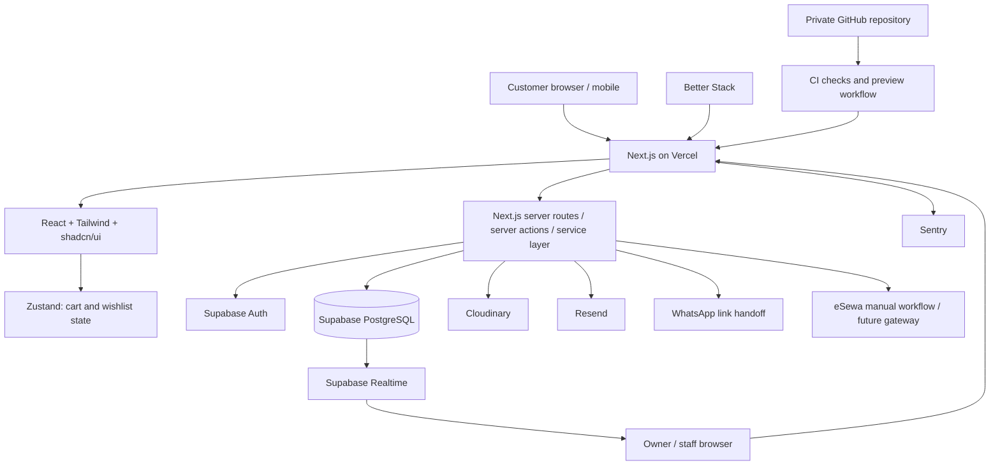

# NP Wardrobe — Technical Requirements Document (TRD)

**Document status:** Approved technical discovery baseline  
**Version:** 1.0  
**Date:** 13 November 2026  
**Product:** NP Wardrobe ecommerce website and administration system  
**Related documents:** `PROJECT_OVERVIEW.md`, `PRD.md`  
**Primary market:** Nepal  
**Primary currency:** NPR, displayed as `रु.`

---

## 1. Purpose of this document

This Technical Requirements Document defines the approved technical direction, system boundaries, engineering standards, integration requirements, security controls, testing approach and deployment expectations for NP Wardrobe.

The **PRD defines what NP Wardrobe must do**. This document defines the technical approach the development team and AI coding agents should use to build it. The detailed relational data model will be specified separately in `BACKEND_SCHEMA.md`; the ordered delivery sequence will be specified in `IMPLEMENTATION_PLAN.md`.

This document is the technical source of truth unless the owner approves a change. AI agents must not silently replace selected technologies, invent external service credentials, weaken security rules or change business behaviour to make implementation easier.

### 1.1 Product context

NP Wardrobe is a premium women's fashion ecommerce business serving customers across Nepal. The application includes:

- A mobile-first public storefront.
- A customer account area with guest checkout still available.
- A cart, checkout and order-recording workflow.
- WhatsApp order handoff to `+977 9740258617`.
- COD and an initial manual eSewa payment workflow.
- Variant-level stock management and reservations.
- A secure administration dashboard for store operations.
- A foundation for later automation, reporting and integrations.

The design baseline is the approved Google Stitch design and `PROJECT_OVERVIEW.md`: Cream + Rose Gold, Cormorant Garamond headings, DM Sans body text, a premium/feminine tone, and mobile-first layouts. The design reference is H&M's clear shopping experience; NP Wardrobe must retain its own identity and must not copy H&M assets or branding.

### 1.2 Business constraints to preserve

| Item | Approved value |
|---|---|
| Brand | NP Wardrobe |
| Main customer group | Women aged 18–45 |
| Catalogue | Western, ethnic, casual, partywear and accessories |
| Initial product count | Approximately 11–30 products |
| Typical price range | रु. 3,000–6,000 |
| Delivery market | Nepal, subject to configured serviceability |
| Currency | NPR (`रु.`) |
| Main support channel | WhatsApp Business |
| WhatsApp number | `+977 9740258617` |
| Preferred domain | `www.npwardrobe.com.np` — registration and ownership must be confirmed |
| Initial business target | 20–50 orders per month during the first three months |

---

## 2. Architecture principles

All technical decisions must follow these principles:

1. **Mobile-first:** Optimize storefront and essential admin workflows for phones before expanding to larger screens.
2. **Server-authoritative commerce:** The browser must never be trusted for final prices, discounts, delivery charges, stock, payment status or permissions.
3. **Record before redirect:** Persist an order successfully before opening WhatsApp.
4. **Atomic inventory:** Stock reservation and release must be concurrency-safe; two customers must not reserve the same last unit.
5. **Separate order and payment states:** A confirmed order is not necessarily paid; a paid order is not necessarily shipped.
6. **Secure by default:** Use least privilege, database RLS, server-side authorization, secret management and private file storage for sensitive uploads.
7. **Phased delivery:** Ship a dependable Phase 1 before implementing advanced automation. Do not add unnecessary infrastructure to the initial launch.
8. **Reversible changes:** Use database migrations, Git history, preview deployments and rollback procedures.
9. **Observable behaviour:** Important order, stock and payment actions must be logged and testable.
10. **No invented business facts:** Unknown merchant IDs, QR codes, policies, delivery prices, courier promises and service credentials remain explicit placeholders until supplied and verified.
11. **Design fidelity:** Implement the approved Stitch design and shared design system rather than creating a generic template.
12. **Documented decisions:** Any change to the approved stack or architecture requires a short decision record explaining the reason, impact and migration path.

---

## 3. Approved technology stack

The following technologies were selected during the TRD discovery interview.

| Area | Approved technology | Main responsibility |
|---|---|---|
| Development approach | AI-assisted custom development | AI coding agents build from approved design and project documents |
| Web framework | Next.js | Storefront, customer area, admin application and server-side operations |
| UI framework | React | Interactive interface components |
| Database | Supabase PostgreSQL | Products, variants, customers, orders, payments, inventory and operational records |
| Backend model | Hybrid Next.js + Supabase | Next.js handles business workflows; Supabase supplies database, auth and platform services |
| Image service | Cloudinary | Public product, promotional and editorial images; image transformation and delivery |
| Styling | Tailwind CSS | Responsive styling and design tokens |
| UI components | shadcn/ui | Accessible, customizable base components |
| Client state | Zustand | Cart, wishlist and transient interface state |
| Forms | React Hook Form | Form state and submission UX |
| Validation | Zod | Shared input validation schemas, especially server-side validation |
| Authentication | Supabase Auth | Email/password, phone OTP and Google sign-in when configured |
| Hosting/deployment | Vercel | Next.js hosting, previews and production deployment |
| Source control | Private GitHub repository | Source code, review, history and collaboration |
| Transactional email | Resend | Account and transactional messages when enabled |
| Error monitoring | Sentry | Application and runtime error reporting |
| Uptime monitoring | Better Stack | Availability checks and incident monitoring |
| End-to-end testing | Playwright | Full customer and admin journeys |
| Unit testing | Vitest | Business logic, utilities and calculations |
| Component testing | React Testing Library | Component behaviour and accessibility-oriented interactions |

### 3.1 Engineering conventions to adopt at project initialization

The owner selected the core stack but did not separately choose every engineering convention. The following are recommended defaults for AI agents to adopt and record in the repository:

- Use **TypeScript** throughout the application; enable strict type checking.
- Use the **Next.js App Router** unless the repository or a documented technical constraint requires otherwise.
- Keep server-side and client-side modules clearly separated.
- Use a single package manager and commit its lockfile. The implementation lead should select and document the package manager before the first shared build.
- Add consistent linting, formatting and type-check scripts.
- Pin compatible dependency versions through the lockfile; do not use floating or unreviewed major-version upgrades in production.
- Use environment-specific configuration and never commit secrets.
- Prefer small, reusable, typed modules over large page components.

These conventions are implementation standards, not permission to replace the approved technology stack.

---

## 4. High-level system architecture



### 4.1 Responsibility boundaries

**Next.js application**
- Renders public pages, customer account pages and admin pages.
- Provides server-side endpoints/actions for privileged business workflows.
- Validates and authorizes every sensitive operation.
- Coordinates database transactions and integrations.
- Generates SEO metadata and localized routes.

**Supabase**
- PostgreSQL is the system of record for structured business data.
- Supabase Auth manages customer and staff identities.
- RLS restricts data access at the database boundary.
- Realtime publishes permitted changes to subscribed clients.
- Supabase Storage may be used for private files, particularly sensitive payment proof uploads, subject to the final storage policy.

**Cloudinary**
- Stores and delivers public product imagery, homepage banners and other approved public visual media.
- Generates responsive image transformations and optimized formats.
- Must not expose sensitive customer or payment documents through public asset URLs.

**Vercel**
- Hosts the Next.js application and preview deployments.
- Provides environment-specific configuration and deployment integration.

**GitHub**
- Stores source code and database migrations.
- Tracks reviews, branches, issues and CI results.
- Is the source of truth for code changes.

---

## 5. Application architecture and code organization

### 5.1 Application areas

The application should be organized into clear areas:

- **Storefront:** Home, shop, category, collection, product, cart, checkout, content pages and public order lookup.
- **Customer account:** Profile, addresses, orders, wishlist, reviews and request history.
- **Admin:** Dashboard, products, variants, inventory, orders, payments, delivery, returns, promotions, content, reports, staff and settings.
- **Server services:** Order, inventory, pricing, payment, delivery, notification, content and authorization services.
- **Shared UI/design system:** Brand tokens, buttons, forms, product cards, navigation, dialogs, tables, status labels and feedback states.

### 5.2 Recommended folder boundaries

The exact folder names may evolve, but keep responsibilities equivalent to this structure:

```text
src/
  app/                     # Next.js routes and layouts
    (storefront)/          # Public shopping pages
    (account)/              # Customer account pages
    admin/                  # Protected admin pages
    api/                    # Route handlers / webhooks
  components/
    ui/                     # shadcn/ui primitives and local wrappers
    storefront/             # Storefront-specific components
    admin/                  # Admin-specific components
    forms/                  # Shared form components
  features/
    products/
    cart/
    checkout/
    orders/
    inventory/
    payments/
    customers/
    promotions/
    content/
  lib/
    supabase/               # Browser/server Supabase clients
    cloudinary/
    auth/
    validation/
    currency/
    seo/
    observability/
  services/                 # Server-only business workflows
  stores/                   # Zustand stores
  types/                    # Shared types generated or maintained from schema
  i18n/                     # Locale configuration and dictionaries
supabase/
  migrations/               # Version-controlled SQL migrations
  seed/                     # Non-production seed data
  tests/                    # Database/RLS tests where applicable
tests/
  e2e/                      # Playwright tests
  components/               # React Testing Library tests
```

### 5.3 Component and code rules

- Keep UI presentation separate from business rules.
- Do not call privileged database operations directly from browser components.
- Keep reusable domain logic in tested services or pure functions.
- Use shared validation schemas where a form is validated on both client and server; server validation remains authoritative.
- Avoid duplicating product price, stock, order or permission rules across components.
- Do not create a second source of truth for data already stored in PostgreSQL.
- Use loading, empty, success and failure states for asynchronous operations.

---

## 6. Backend and request handling

### 6.1 Hybrid backend approach

Use Supabase for database, authentication, RLS and platform services. Use Next.js server-side code for business workflows that require validation, coordination, authorization or calls to external providers.

Examples of server-side workflows:
- Create order and reserve stock.
- Recalculate price, discount and delivery fee.
- Confirm or cancel an order.
- Commit or release inventory reservations.
- Verify or reject manual payment proof.
- Apply promotion eligibility rules.
- Create signed media-upload instructions.
- Handle future eSewa or WhatsApp callbacks.
- Manage staff permissions and protected settings.

### 6.2 Request handling rules

Every sensitive request must:

1. Validate its input using a server-side schema (Zod or equivalent).
2. Identify the requesting user or guest session.
3. Check authorization on the server and, where data access uses Supabase, through RLS as well.
4. Re-read trusted product, price, discount, delivery and stock data from the database.
5. Perform state changes through a transaction or a concurrency-safe database operation.
6. Return a minimal response without exposing secret keys or unrelated customer information.
7. Log the relevant operation, result and correlation/reference ID without logging credentials or unnecessary personal data.

### 6.3 Database access

- Use separate Supabase clients appropriate for browser and server contexts.
- Use the authenticated user's session for customer-scoped operations.
- Use the Supabase service-role key only in trusted server-only modules when a privileged operation is genuinely required.
- Never include a service-role key in a `NEXT_PUBLIC_` variable or browser bundle.
- Apply RLS to every table or view that contains non-public information.
- Prefer narrowly scoped database functions/RPCs for operations that need atomic transactions, such as stock reservation and order creation.
- Use SQL migrations committed to GitHub; do not make undocumented production-only schema changes in a dashboard.

---

## 7. Database and data integrity requirements

The detailed table definitions, columns, relationships, indexes and constraints belong in `BACKEND_SCHEMA.md`. The TRD establishes these data integrity requirements:

- Use PostgreSQL as the single source of truth for products, variants, inventory, orders, payments, customers, promotions and operational records.
- Use primary keys and foreign keys for entity relationships.
- Add unique constraints for values that must be unique, such as order references and variant SKUs where applicable.
- Add indexes for common lookups: product slug/SKU, category, variant, order reference, customer, order status, payment status and timestamps.
- Use database constraints for essential invariants where practical, not only form validation.
- Use transactions for workflows that change multiple related records.
- Maintain audit/history records for stock adjustments, order status changes, payment verification, refunds, permissions and sensitive administrative actions.
- Preserve order-time snapshots of product name, selected variant, SKU, unit price, discount, delivery charge and total. Catalogue edits must not rewrite historical orders.
- Store timestamps consistently in UTC; display them using the appropriate Nepal local time (`Asia/Kathmandu`).
- Use explicit status enums or constrained status values managed through migrations.
- Do not store raw card details, passwords or unnecessary sensitive data.

### 7.1 Currency and money representation

- The store currency is NPR.
- Customer-facing values use the `रु.` symbol, for example `रु. 3,500`.
- Do not use JavaScript floating-point arithmetic for authoritative money calculations.
- Store monetary amounts in an exact representation: integer paisa (recommended) or a fixed-precision decimal type. The selected convention must be used consistently across database, API and tests.
- The final implementation should use a shared currency utility for formatting, rounding and calculation.
- The server calculates all authoritative totals; client-submitted totals are informational only.

### 7.2 Database migrations

- Every schema change must be represented by a migration committed to the repository.
- Migrations must be ordered, reviewable and safe to apply to a new environment.
- Destructive migrations require an explicit review and a backup/rollback plan.
- Seed realistic but clearly fictitious products only in development/staging.
- Never seed test customer data, fake payment proof or placeholder merchant credentials into production.

---

## 8. Authentication, accounts and authorization

### 8.1 Supabase Auth

The target authentication options are:
- Email and password.
- Phone number with one-time passcode (OTP).
- Google sign-in via OAuth.
- Guest checkout without account registration.

Phone OTP requires selecting and configuring an SMS provider that reliably supports Nepal `+977` numbers. That provider remains an open decision. Google sign-in requires OAuth client configuration and approved redirect URLs. Do not show a sign-in method as operational until its credentials, callback flow and tests are complete.

### 8.2 Customer and staff roles

The system must distinguish at least:
- Guest.
- Registered customer.
- Owner/super administrator.
- Order manager.
- Inventory manager.
- Customer support staff.
- Marketing/content manager.
- Other custom staff roles approved by the owner.

The final permission matrix will be defined in `BACKEND_SCHEMA.md` and refined during admin implementation. Permissions must be enforced on the server and in RLS—not merely by hiding buttons in the interface.

### 8.3 Authentication security

- Protect admin routes and server operations with verified authentication and role checks.
- Require multi-factor authentication for privileged admin accounts, using a supported and tested factor.
- Do not trust user-editable metadata as proof of an admin role.
- Use secure session handling and logout behaviour.
- Configure password reset and account recovery flows.
- Apply rate limits or abuse controls to OTP and login endpoints.
- Avoid revealing whether a phone number or email is registered where that could enable account enumeration.
- Revoke staff access promptly when an account is disabled or removed.

---

## 9. Commerce workflows and technical invariants

### 9.1 Cart architecture

- Use Zustand for cart state and a persistence middleware or equivalent to save the cart to `localStorage`.
- Handle Next.js server rendering safely: do not read `localStorage` during server rendering; hydrate client state without a visible incorrect-cart flash where practical.
- A cart line is identified by product and selected variant combination, not product ID alone.
- Store item identifiers and selected variant in the client cart; treat cached names/prices as display hints only.
- On checkout, re-fetch current product/variant information and recalculate all amounts on the server.
- Merge guest cart with an account cart according to a documented, tested rule when the customer signs in.
- Cart persistence is a convenience feature, not an inventory reservation. Stock is reserved only by the server order workflow.

### 9.2 Pricing and promotions

- Server-side pricing is authoritative.
- Recalculate product prices, active discounts, coupon eligibility, delivery fee and final total at checkout.
- Validate promotion dates, product/category eligibility, minimum order amount, usage limits and stacking rules.
- The exact coupon stacking/precedence policy must be configured before launch.
- Return a structured price breakdown so the customer can review changes before confirming.
- Record the applied discount and rule snapshot on the order.

### 9.3 Order creation and idempotency

The order creation workflow must be safe against double taps, browser retries, timeouts and duplicate network requests.

Recommended sequence:

1. Client submits customer, address, cart item IDs/variants/quantities, payment selection and an idempotency identifier.
2. Server validates the request and identifies the guest or authenticated customer.
3. Server fetches trusted product, variant, price, promotion, COD and delivery data.
4. Server calculates the full order total.
5. Server performs stock availability check and reservation atomically.
6. Server creates the order, immutable order item snapshots, payment record/state and initial status history in a transaction.
7. Server returns the durable order reference and WhatsApp message data needed by the client.
8. Client displays the order-saved state and attempts to open the pre-filled WhatsApp link.
9. If WhatsApp fails to open, the order remains saved and the customer receives the order reference and alternative contact instructions.

Use a unique idempotency key or equivalent constraint so repeating the same checkout request does not create duplicate orders or reservations.

### 9.4 WhatsApp handoff

- Destination: `https://wa.me/9779740258617`.
- Generate the pre-filled message from server-confirmed order data.
- Include order reference, customer name, phone, delivery address, product names, variant/size/colour, quantities, item prices, subtotal, delivery charge, total and payment method, in line with the approved PRD.
- URL-encode the message safely.
- Do not expose service credentials or internal data in the link.
- Tell the customer that the order has been saved and WhatsApp is the next communication step.
- Never report that the customer sent the message or that the store confirmed the order merely because the WhatsApp link opened.
- Because the WhatsApp message contains personal information, provide a concise privacy notice near checkout and avoid sending this content to analytics or application logs.

### 9.5 Order lifecycle

Order status and payment status must be separate.

Initial order lifecycle values should cover:
- `pending` — order recorded and awaiting manual review/confirmation.
- `confirmed` — authorized staff accepted the order.
- `processing` — order is being prepared.
- `shipped` — handed to a delivery provider or dispatched.
- `delivered` — delivery is complete.
- `cancelled` — order was cancelled through an authorized action.

Additional internal states such as rejected or on-hold may be introduced only with a documented mapping to customer-visible states. Every transition must be validated against an allowed transition map and written to order status history with actor and timestamp.

### 9.6 Inventory reservation

Inventory is tracked at sellable variant level (for example, a particular product + size + colour).

Required behaviour:
- Available-to-sell quantity must account for active reservations.
- Order submission must reserve all required variant quantities atomically.
- If any requested variant cannot be reserved, fail the transaction and do not create a partially reserved order.
- Confirming an order commits the reservation exactly once; the implementation must not double-decrement inventory.
- Eligible cancellation releases the reservation.
- Expired reservations are released by a scheduled process.
- Reservation duration remains a launch configuration decision.
- Manual stock adjustments require a reason and audit record.
- Returns must not automatically restore sellable inventory; an authorized inspection/restock decision is required.

Use database transactions, row-level locking, conditional updates or an equivalent PostgreSQL-safe concurrency mechanism. Do not rely on a browser check followed by a later unprotected stock update.

### 9.7 Payment model

Payment status is independent from order status. At minimum, the design must represent pending/unpaid, pending verification, paid, failed/rejected, refunded and partially refunded where required.

#### COD — Phase 1
- COD eligibility is controlled by location, order amount, product restrictions and optional advance payment.
- Admin can enable/disable COD and change its rules.
- The selected COD terms are recorded with the order.
- A COD order is not treated as prepaid merely because it is confirmed.
- Collection of COD funds can be marked as collected by an authorized admin during fulfilment.

#### eSewa manual workflow — Phase 1
- Display only the real merchant ID, instructions and QR image supplied and verified by the owner.
- Allow payment reference and/or proof upload according to the final checkout configuration.
- New submissions remain `pending_verification` until an authorized admin verifies them.
- Payment proof must be stored privately and accessible only to authorized staff and, where appropriate, the submitting customer.
- Record verifier, timestamp, reference and decision.
- Never mark payment as paid from a client-side claim or screenshot upload alone.

#### Official eSewa gateway — Phase 2
- Integrate only after merchant onboarding and official technical requirements/credentials are confirmed.
- Verify payment server-side using the provider's documented verification mechanism.
- Validate callback authenticity, transaction/order reference, amount and currency.
- Make callback processing idempotent.
- Never trust a browser redirect alone as proof of payment.
- Keep credentials server-side and log state transitions without exposing secrets.

### 9.8 Delivery and shipping

- Delivery fee calculation is server-side.
- Rules may be location-based, threshold-based or promotional.
- An authorized admin may apply a custom fee with a reason and audit event.
- Do not invent a price or delivery timeline when no rule exists.
- Admin can record courier, tracking number, dispatch information and status manually in Phase 1.
- Future courier APIs must be isolated behind provider adapters so the order model does not depend on one carrier.
- Delivery charge and relevant rule snapshot must be preserved with the order.

### 9.9 Cancellation, return and exchange

- Requests are associated with an order and, where appropriate, individual order items.
- Eligibility is checked against the order lifecycle and owner-approved policy.
- Admin decisions require an actor, timestamp and reason.
- Approved pre-shipment cancellations release active reservations exactly once.
- Refund records are separate from the cancellation decision and must reflect actual payment handling.
- Returned goods only re-enter sellable inventory after inspection and explicit restock approval.
- Do not invent return windows, conditions, refund times or fees; those must be supplied by the owner and managed as content/configuration.

---

## 10. Media, files and uploads

### 10.1 Cloudinary use

Use Cloudinary for public visual assets:
- Product photographs.
- Product image galleries.
- Homepage and category banners.
- Editorial/fashion imagery.
- Approved customer review photos.

Requirements:
- Upload through a controlled flow; use signed upload parameters generated by the server where appropriate.
- Validate file type, file size, dimensions and ownership before accepting assets.
- Use stable asset IDs and store references in PostgreSQL.
- Generate responsive transformations and optimized formats.
- Provide useful alt text in product/content records.
- Do not allow arbitrary public uploads without moderation and abuse protection.
- Do not delete an asset still referenced by a published product or page without an explicit confirmation and reference check.

### 10.2 Private documents

Payment screenshots/proof and any other sensitive customer documents must not be placed in a publicly accessible Cloudinary folder or exposed through an unprotected asset URL. Prefer a private Supabase Storage bucket or another private storage mechanism with authorization and short-lived access URLs. This use of Supabase Storage is for private files, not a replacement for Cloudinary's approved public-image role.

### 10.3 Upload security

- Allow only required file types.
- Enforce upload size limits.
- Validate MIME type and actual file content where possible.
- Generate safe filenames/identifiers rather than trusting user filenames.
- Apply access controls and moderation to customer-submitted review photos.
- Ensure private files cannot be downloaded by another customer by guessing an ID or URL.

---

## 11. Authentication integrations and external services

### 11.1 Supabase Auth

Configure email/password, phone OTP and Google OAuth as approved options. Keep guest checkout independent of authentication. Provider-specific setup, redirect URLs, rate limits and testing must be completed before enabling a method in production.

### 11.2 SMS provider — decision pending

The provider has not yet been selected. Before selection, compare Nepal `+977` delivery quality, per-message cost, sender ID/template rules, delivery reporting, API reliability, documentation, support and compatibility with Supabase Auth. Keep the SMS integration replaceable behind a small adapter/configuration boundary.

### 11.3 Resend

Use Resend for transactional email when email notifications are enabled. Requirements include verified sending domain, DNS configuration, branded templates, error handling, retry policy and unsubscribe/consent handling for non-essential marketing email. Transactional and marketing messages must be distinguished.

### 11.4 WhatsApp

Phase 1 uses a pre-filled `wa.me` handoff and floating WhatsApp contact link. Phase 2 may add an approved WhatsApp Business messaging provider/API for automated notifications. Do not claim automated messages are active before the provider, number, template approvals and consent requirements are configured.

### 11.5 eSewa

Phase 1 uses manual QR/reference/proof and admin verification. Phase 2 can add the official gateway after merchant onboarding and technical verification. Keep payment provider-specific code behind an adapter/service so it can be integrated without changing the core order model.

---

## 12. Search, multilingual support and SEO

### 12.1 Search

Phase 1 uses PostgreSQL-based search and filters. Support product name/text, category, size, colour, price range and availability. Add appropriate database indexes and test query performance against the expected catalogue size. Keep a search service boundary so Meilisearch or Algolia can be considered later without rewriting product pages.

The dedicated search engine is not selected. It should be introduced only when real catalogue size, search quality or traffic justifies its additional cost and operational burden.

### 12.2 Multilingual support

Initial languages are English and Nepali. The architecture must support future language additions.

- Use translation dictionaries/files for interface labels and common UI messages.
- Store language-specific product/content fields in the database where content is managed by admins.
- Avoid hard-coded customer-facing text scattered through components.
- Provide a language switcher.
- Persist language preference appropriately.
- Ensure form errors, checkout, order messages and key content can be translated.
- Use localized URLs and language metadata.
- The final URL convention (for example `/en/...` and `/ne/...`) must be chosen before routing implementation and documented.
- Do not use machine-translated business policies as approved legal/policy content without owner review.

### 12.3 SEO and social sharing

Every public indexable page must support:
- Unique HTML title.
- Unique meta description.
- Canonical URL.
- Open Graph title, description and image.
- Appropriate social-sharing metadata.
- Descriptive alt text for informative images.
- Semantic heading hierarchy.
- XML sitemap and `robots.txt`.
- Structured data where accurate and useful (such as Organization, Product and Breadcrumb data).

Customer account, checkout, admin and private tracking pages must not expose private data in search indexing; apply appropriate `noindex` rules. Never publish internal customer/order information in metadata or structured data. The preferred domain is `www.npwardrobe.com.np`, but production canonical URLs must not be activated until domain ownership and DNS are confirmed.

---

## 13. Admin dashboard, CMS and real-time updates

### 13.1 Admin access

- Admin routes require verified staff authentication and role permissions.
- The owner role has full access.
- Other staff roles have only explicitly granted capabilities.
- Sensitive actions require server authorization regardless of visible UI controls.
- Staff account creation, role change and deactivation must be audited.

### 13.2 Admin modules

The admin application should support:
- Dashboard and operational summary.
- Product and product-variant management.
- Inventory and stock adjustments.
- Categories, subcategories and collections.
- Order queue and order details.
- Payment review and verification.
- Delivery rules, courier and tracking details.
- Cancellation, return and exchange requests.
- Promotions and coupon management.
- Customer information and order history.
- Review moderation.
- Homepage/page content management.
- FAQ, size guide and policy content.
- SEO metadata.
- Sales and operational reports.
- Staff, permissions and audit history.
- Store settings and integrations.

Implement the modules according to the PRD phases. Do not let advanced dashboard work block the Phase 1 order workflow.

### 13.3 Custom CMS

Build content editing into the custom admin system. Authorized staff should be able to manage banners, homepage sections, ordering of sections, content blocks, FAQs, About Us, policies, size-guide content, SEO metadata and promotional content without coding. Advanced scheduling and preview/publish workflows may be staged according to the PRD.

### 13.4 Real-time updates

Use Supabase Realtime where it is appropriate and authorized for:
- New order notifications.
- Order status changes.
- Inventory changes.
- Payment status changes.
- Relevant staff activity updates.
- Multi-admin synchronization.

Realtime is a notification/update channel, not the source of truth. Clients must refetch or verify the persisted database state after important events. Apply RLS and channel authorization. Avoid broadcasting private customer details to unauthorized users. Provide a refresh/reconnect fallback when realtime disconnects.

---

## 14. Background jobs and scheduled work

The scheduling platform remains undecided. The technical team must compare:
- Vercel Cron Jobs.
- Supabase scheduled functions/cron capabilities.
- A dedicated background job service.

Select the simplest reliable option that meets the requirements and current platform limits/costs. Keep job execution replaceable and avoid coupling core business logic to one scheduler.

Jobs may include:
- Releasing expired stock reservations.
- Starting and ending scheduled promotions.
- Processing abandoned-cart signals.
- Sending scheduled notifications.
- Producing scheduled reports.
- Retrying recoverable integration failures.

All jobs must be idempotent, observable, retry-safe and safe to execute more than once. A scheduled task must not double-release stock, send duplicate payment actions or create duplicate orders. Job failures must be visible to administrators/monitoring.

---

## 15. Analytics and business reporting

The external analytics provider remains undecided. Compare Google Analytics 4 and PostHog for ecommerce events, privacy, data residency/consent implications, cost, implementation effort and performance impact before selecting one.

The custom admin dashboard remains the trusted source for operational business figures derived from stored orders and payments. External analytics tools must not be treated as the source of truth for revenue or payment status.

Recommended events include:
- Product viewed.
- Search performed.
- Filter applied.
- Add to cart.
- Remove from cart.
- Begin checkout.
- Order submitted.
- WhatsApp handoff attempted.
- Payment proof submitted.
- Wishlist add/remove.

Do not send phone numbers, full names, addresses, payment references, order message contents or other unnecessary personal data to analytics. Apply consent and privacy controls appropriate to the chosen tool and business requirements.

---

## 16. Security requirements

### 16.1 Application security

- Validate all untrusted input on the server.
- Enforce authentication and authorization for every protected operation.
- Protect against common web risks such as injection, cross-site scripting, cross-site request forgery where applicable, insecure direct object references, open redirects and unsafe file upload.
- Use secure HTTP settings and HTTPS in production.
- Apply reasonable rate limits and abuse protection to login, OTP, public order lookup, review submissions and checkout endpoints.
- Avoid exposing stack traces, database details or secrets to customers.
- Keep dependencies patched through reviewed updates.

### 16.2 Supabase security

- Enable and test RLS on all non-public tables.
- Public users may read only approved published catalogue/content data.
- Customers may access only their own profile, addresses, orders, payments and wishlist, subject to the defined guest-order access mechanism.
- Staff may access operational records only within their assigned permissions.
- Admin/owner capabilities must be enforced server-side and in database policies.
- Never trust a role stored in client-editable user metadata.
- Service-role credentials must remain server-only.
- Test RLS with anonymous, customer, staff and owner identities.

### 16.3 Secrets and environment variables

- Store provider secrets only in Vercel/GitHub secret stores or an approved secret manager.
- Never commit `.env` files containing secrets.
- Provide `.env.example` containing names and descriptions only, with no real values.
- Prefix only intentionally public configuration with `NEXT_PUBLIC_`.
- Rotate any credential accidentally exposed in code, logs or chat.
- Restrict production access to the smallest necessary group.

### 16.4 Admin security

- Enforce MFA for privileged admin accounts.
- Protect privileged actions with server-side authorization.
- Record actor, timestamp, action and relevant object for sensitive changes.
- Apply session expiry and account deactivation controls.
- Avoid exposing payment proof or customer contact details to staff without permission.

### 16.5 Privacy

- Collect only data necessary for account access, order fulfilment, payment verification and customer support.
- Provide clear privacy information and policy links.
- Limit retention of sensitive uploads and logs to approved periods.
- Do not include personal data in error tracking or analytics unless necessary and explicitly controlled.
- Define customer data access/deletion and retention procedures before public launch.

---

## 17. Performance, accessibility and PWA

### 17.1 Performance

- Use Next.js rendering and caching capabilities appropriately; never cache private customer or admin responses publicly.
- Use Cloudinary transformations and responsive images.
- Lazy-load non-critical imagery and defer non-essential scripts.
- Avoid excessive client-side JavaScript and animation.
- Paginate or progressively load large product/admin lists.
- Add database indexes based on real query patterns.
- Monitor real-user performance after launch.
- Define and approve measurable performance budgets before production release. Proposed targets should be measured on representative mobile devices and network conditions, not assumed from desktop testing.

### 17.2 Accessibility

- Use semantic HTML and accessible labels.
- Ensure keyboard navigation and visible focus indicators.
- Provide sufficient colour contrast for Cream/Rose Gold combinations.
- Do not communicate status using colour alone.
- Add meaningful alt text to informative images; mark purely decorative images appropriately.
- Ensure dialogs, menus, forms and validation messages are accessible.
- Test major flows with keyboard and automated accessibility checks.

### 17.3 PWA and low-connectivity behaviour

PWA/installable experience and expanded offline-friendly capabilities are planned enhancements. Do not cache private account/order/payment data in a way that exposes it on shared devices. Offline behaviour must clearly distinguish cached content from current stock, pricing and order status. Checkout, stock reservation and payment verification require a live server connection.

---

## 18. Monitoring, logging and reliability

### 18.1 Sentry

Use Sentry for application exceptions and performance issues. Configure appropriate source maps and release identifiers. Scrub sensitive information such as authentication tokens, addresses, phone numbers, payment references and WhatsApp message content from captured events.

### 18.2 Better Stack

Use Better Stack for uptime monitoring and incident notifications. Monitor the public storefront and suitable health endpoints without exposing internal secrets or database details.

### 18.3 Application logs

- Use structured logs with timestamp, severity, environment, service and correlation ID.
- Log order/payment/stock state changes without logging unnecessary personal data.
- Keep secrets, tokens and full payment documents out of logs.
- Include enough information to diagnose failed workflows.
- Provide retry and failure visibility for jobs and external integrations.

### 18.4 Reliability behaviours

- A WhatsApp popup failure must not undo a saved order.
- A failed email notification must not undo a valid order.
- A failed realtime connection must not prevent the admin from refreshing and viewing persisted data.
- A failed provider callback must be retryable without duplicate payment/order transitions.
- External service timeouts must return safe, understandable customer messages.

---

## 19. Testing and quality assurance

### 19.1 Required tools

| Tool | Responsibility |
|---|---|
| Vitest | Unit tests for pricing, stock logic, state transitions, validators and utilities |
| React Testing Library | Component behaviour, form interactions and feedback states |
| Playwright | End-to-end storefront, checkout, account and admin journeys |

### 19.2 Test layers

**Unit tests**
- Currency formatting and calculations.
- Discount and coupon eligibility.
- Delivery charge rules.
- Order transition rules.
- Inventory reservation/commit/release logic.
- Validation schemas.
- WhatsApp message formatting and URL encoding.

**Component tests**
- Product variant selectors.
- Cart quantity controls.
- Checkout form validation.
- Payment method selection.
- Admin status controls.
- Accessible menus, dialogs and error feedback.

**End-to-end tests**
- Browse category → product → select variant → add to cart.
- Cart persistence after refresh.
- Guest checkout and order creation.
- WhatsApp handoff and failure fallback.
- Manual eSewa pending verification and admin approval.
- COD availability rules.
- Stock reservation under concurrent checkout attempts.
- Customer account and order history.
- Staff permission enforcement.
- Cancellation and reservation release.

**Operational tests**
- Database migration on a clean environment.
- RLS tests for anonymous, customer, staff and owner roles.
- Backup restoration exercise.
- Deployment rollback exercise.
- Mobile layout and performance checks.
- Accessibility checks.
- Security checks for secrets, uploads and protected endpoints.

### 19.3 Test data rules

- Use fictitious test identities and products in development/staging.
- Never use real customer information in automated tests unless specifically authorized and protected.
- Do not use real eSewa merchant credentials or real payment transactions in automated tests unless the owner has approved a safe test process.
- Clearly label mock payment providers and simulated order states.
- Production must not contain demo orders, fake reviews or placeholder payment credentials.

---

## 20. Environments, source control and CI/CD

### 20.1 Required environments

Maintain three distinct environments:

1. **Development:** Local and shared developer work. Uses non-production database and test credentials.
2. **Staging:** Persistent pre-production environment for full workflow and owner acceptance testing.
3. **Production:** Live store and real customer data.

Use separate Supabase projects or equally strong isolation for development, staging and production. Do not point preview deployments at the production database. Cloudinary credentials/folders and email/payment integrations must also be environment-separated where supported.

### 20.2 GitHub workflow

- Keep the repository private.
- Protect the production branch.
- Use feature branches and pull requests.
- Require relevant checks before merging.
- Keep database migrations and automated tests in version control.
- Require review for migrations, security-sensitive code and payment/inventory workflows.
- Do not allow AI agents to push unreviewed changes directly to production.

### 20.3 CI/CD pipeline

The approved deployment approach is a professional pipeline with:

1. Dependency installation from the lockfile.
2. Formatting/lint checks.
3. Type checking.
4. Unit and component tests.
5. Build verification.
6. Security/dependency checks.
7. Database migration validation and relevant RLS tests.
8. Preview deployment.
9. Staging end-to-end and owner acceptance tests.
10. Explicit approval before production deployment.
11. Production health check.
12. Documented rollback path.

The implementation team may use GitHub Actions and Vercel deployment checks, selecting a maintainable combination. The exact pipeline configuration must be documented in the repository.

### 20.4 Database deployment

- Review migrations separately from application code where risk warrants.
- Apply migrations to development and staging before production.
- Back up production before risky or destructive changes.
- Use backward-compatible expand/migrate/contract patterns for changes that cannot safely deploy in one step.
- Never apply unreviewed schema changes directly to production.

---

## 21. Backup and disaster recovery

The approved direction is complete disaster recovery. The specific retention period, recovery point objective (RPO) and recovery time objective (RTO) must be agreed before production launch.

Requirements:
- Configure automated database backups supported by the chosen Supabase plan and architecture.
- Enable point-in-time recovery if available and justified by the selected plan.
- Maintain a separate backup/export strategy so recovery does not depend on one credential or one platform feature.
- Back up database and critical configuration/migration assets.
- Protect backups with encryption and limited access.
- Keep secrets out of backup files where possible; manage them through secure configuration.
- Define a retention policy.
- Test restoration periodically and after major schema/platform changes.
- Document who can initiate restoration and how the team validates restored orders, inventory and payment records.
- Include Cloudinary media and private uploaded files in the asset-recovery plan; database backups alone do not restore external media.

Do not promise point-in-time recovery, retention duration or backup frequency until the selected Supabase plan and backup configuration are verified.

---

## 22. Open technical decisions and research tasks

The following choices were intentionally left for technical evaluation. AI agents must research, compare and document the recommendation before implementing them. Do not fabricate provider capability, price or availability.

| Decision | Options to evaluate | Selection criteria | Required output |
|---|---|---|---|
| Nepal SMS/OTP provider | Nepal-based gateways and international providers | `+977` delivery quality, price, sender rules, API, support, Supabase compatibility | Comparison and selected provider |
| Scheduled jobs | Vercel Cron, Supabase scheduling/Edge Functions, dedicated job service | Reliability, retry, idempotency, cost, platform limits | Architecture decision record |
| Analytics | GA4, PostHog or another suitable provider | Privacy, ecommerce events, consent, cost, performance | Provider decision and event plan |
| Dedicated search | PostgreSQL initially; later Meilisearch/Algolia | Catalogue size, search quality, typo tolerance, cost, operations | Trigger criteria and migration plan |
| eSewa gateway | Official merchant integration | Merchant onboarding, official docs, verification, callbacks, testing | Approved integration plan |
| WhatsApp automation | Approved WhatsApp Business solution | Business eligibility, templates, consent, cost, API and support | Phase 2 integration plan |
| Job/backup retention | Supabase/Vercel plan capabilities and external backup options | Current plan limits, cost, RPO/RTO, restore procedure | Verified operations plan |
| Locale route convention | Locale prefix or other stable approach | SEO, usability, translated URLs and routing simplicity | Final route convention |
| Package manager | npm, pnpm or other compatible option | Team familiarity, lockfile, Vercel/CI compatibility | Repository decision |

### 22.1 Decision process

For each open decision:
1. Gather current first-party provider documentation and pricing.
2. Compare at least two viable choices when possible.
3. Identify constraints and hidden costs.
4. Recommend the simplest option that meets the PRD and TRD.
5. Record the decision, date, evidence, cost assumption and migration implications.
6. Obtain owner approval when the decision affects recurring cost, customer data, payment handling or business operations.

---

## 23. Phase-based technical delivery boundaries

### 23.1 Phase 1 — essential launch architecture

Must be delivered and tested:
- Next.js storefront and agreed page templates.
- Supabase PostgreSQL data foundation and migrations.
- Supabase Auth methods that have completed provider configuration; guest checkout regardless of account method availability.
- Product, category, variant and inventory management.
- Persistent cart with server-side price/stock validation.
- Transactional order creation and idempotency.
- Atomic inventory reservation, confirmation and release.
- COD configuration and manual eSewa workflow.
- WhatsApp link handoff after order persistence.
- Essential admin order management.
- Delivery charge rules and manual courier/tracking fields.
- Secure owner/admin permissions and RLS.
- Public SEO metadata and responsive image delivery.
- Sentry and Better Stack monitoring.
- Automated test foundation and CI/CD safeguards.
- Backup/recovery configured and tested to the agreed launch standard.

### 23.2 Phase 2 — advanced capabilities

Add after Phase 1 is stable:
- Official eSewa automatic gateway verification.
- Approved WhatsApp Business automated notifications.
- Advanced email and in-site notification rules.
- Advanced analytics and campaign reporting.
- More complete CMS scheduling/preview features.
- Advanced courier integrations.
- Expanded recommendations and customer behaviour features.
- Advanced PWA/offline-friendly functionality.
- Additional automation, search and loyalty capabilities.

### 23.3 Phase gates

Do not start or declare Phase 2 complete at the expense of Phase 1 data integrity. The owner must be able to receive, review, confirm, fulfil and audit real orders before the store is considered operational.

---

## 24. Technical acceptance criteria

The technical build is acceptable for Phase 1 only when all applicable conditions below are met:

### Architecture and code
- [ ] The repository contains a documented Next.js application using the approved stack.
- [ ] Type checks, lint checks and production build pass in CI.
- [ ] Business logic is separated from presentational components.
- [ ] Environment variables are documented and secrets are not committed.
- [ ] Database changes use version-controlled migrations.

### Database and security
- [ ] RLS is enabled and tested on all non-public data tables.
- [ ] Anonymous users, customers, staff and owners have verified access boundaries.
- [ ] Supabase service-role credentials are server-only.
- [ ] Admin authorization is enforced on server operations.
- [ ] Sensitive uploads are private and protected.
- [ ] Audit history exists for order, inventory and payment decisions.

### Commerce integrity
- [ ] Cart persists after refresh on the same browser.
- [ ] Server recalculates all totals and revalidates stock during checkout.
- [ ] Duplicate checkout submissions do not create duplicate orders.
- [ ] Order record is committed before WhatsApp handoff.
- [ ] WhatsApp message matches the saved order and uses the approved number.
- [ ] WhatsApp failure does not lose the order.
- [ ] Concurrent checkout cannot oversell a variant.
- [ ] Reservation commit, release and expiry are idempotent.
- [ ] Payment state is distinct from order state.
- [ ] Manual eSewa submissions remain unverified until admin approval.

### Customer and admin experience
- [ ] Main customer journeys work on phone, tablet and desktop.
- [ ] Guest checkout works without account creation.
- [ ] Admin can manage products, variants, stock, orders and essential settings.
- [ ] Staff cannot perform actions beyond their permissions.
- [ ] Real-time updates have a safe refetch/reconnect fallback.
- [ ] SEO metadata is unique and correct for each public indexable page.
- [ ] Private pages are not indexed or exposed through metadata.

### Operations
- [ ] Playwright, Vitest and React Testing Library cover critical workflows.
- [ ] Staging tests pass before production approval.
- [ ] Sentry and Better Stack are configured and tested.
- [ ] Backups are configured and restoration has been exercised.
- [ ] A production rollback procedure is documented and tested.
- [ ] Domain, payment merchant details, delivery rules and business policies required for launch are verified.

---

## 25. Rules for AI coding agents

Every AI coding agent working on NP Wardrobe must follow these rules:

1. Read `PROJECT_OVERVIEW.md`, `PRD.md`, this `TRD.md`, and any task-specific documents before coding.
2. Treat the PRD as the source of truth for product behaviour and the TRD as the source of truth for technical architecture.
3. Do not change the approved stack without proposing a documented alternative and receiving approval.
4. Do not invent eSewa credentials, QR codes, SMS providers, delivery prices, courier APIs, legal policies or production customer data.
5. Do not place secret keys in client components, public environment variables, screenshots, logs or GitHub commits.
6. Do not trust prices, discounts, delivery fees, inventory counts, payment status or role values supplied by the browser.
7. Keep order and inventory operations transactional and idempotent.
8. Never remove RLS or weaken authorization to make a feature work. Fix the policy or server flow instead.
9. Add or update tests for every change to pricing, inventory, checkout, payments, permissions or order states.
10. Use migrations for schema changes and include rollback/compatibility notes for risky changes.
11. Do not point development or preview environments to production customer data.
12. Use test credentials and fictitious data outside production.
13. Match the approved Stitch design and shared brand tokens; do not invent a different visual identity.
14. Keep mobile usability, accessibility, SEO and performance in scope for every relevant page.
15. Document incomplete work, assumptions, provider setup steps and known risks in the pull request or task notes.
16. Do not claim a feature is complete until its acceptance criteria and tests pass.
17. Prefer a small, working Phase 1 implementation over an untested advanced feature.
18. Update relevant documentation when an approved technical decision changes.

---

## 26. Dependencies and launch inputs still required

The following real-world inputs must be supplied or confirmed before the related functionality can be enabled in production:

- Domain registration, ownership and DNS access for `npwardrobe.com.np`.
- Vercel, Supabase, Cloudinary, GitHub, Resend, Sentry and Better Stack accounts/configuration.
- eSewa merchant account, verified merchant ID, genuine QR code and payment instructions.
- Selection and configuration of an SMS OTP provider for Nepal.
- Google OAuth credentials and redirect configuration.
- Verified transactional email sending domain and DNS records.
- Approved product photos, accurate prices, size/colour variants and stock counts.
- Actual size chart and garment measurements.
- Delivery areas, courier arrangements and delivery charges.
- Owner-approved COD limits and advance-payment rules.
- Owner-approved cancellation, return, exchange, refund and privacy policies.
- Stock reservation expiry duration.
- Staff roles and the final permission matrix.
- Analytics and scheduled-job provider decisions.
- Backup retention, RPO and RTO targets.

A missing item must remain disabled, clearly marked as pending, or handled through a safe manual process. It must not be fabricated to make a demo appear complete.

---

## 27. Relationship to the remaining project documents

| Document | Purpose | Relationship to this TRD |
|---|---|---|
| `PROJECT_OVERVIEW.md` | Approved business and brand brief | Supplies business context and design direction |
| `PRD.md` | What the product must do | Defines product scope, user stories, priorities and acceptance criteria |
| `TRD.md` | How the product is built technically | Defines architecture, stack, engineering and operational controls |
| `APP_FLOW.md` | How users move through the application | Converts journeys into screen-by-screen and state-by-state flows |
| `UI_UX_DESIGN.md` | How the interface looks and behaves | Converts Stitch design and interaction rules into reusable design specifications |
| `BACKEND_SCHEMA.md` | How business data is structured | Defines tables, relationships, columns, indexes, constraints, RLS and data lifecycle |
| `IMPLEMENTATION_PLAN.md` | How development is executed | Defines phases, tasks, dependencies, milestones, testing gates and agent responsibilities |

If a later document reveals a contradiction, do not silently choose one. Record the conflict and ask the owner to approve the resolution. The implementation plan must not override the PRD or TRD without an approved change.

---

## 28. Document approval and change control

**Approved baseline:** The owner approved the 30-question TRD discovery summary on 13 November 2026. This document expands that approved direction into technical requirements and implementation standards.

Any proposed change to framework, database, authentication, payment handling, storage, deployment, security model or recurring paid service must include:
- Why the change is needed.
- Which requirements it affects.
- Benefits and drawbacks.
- Cost and operational impact.
- Security/privacy impact.
- Migration and rollback plan.
- Whether approval is required before implementation.

**End of TRD v1.0**
